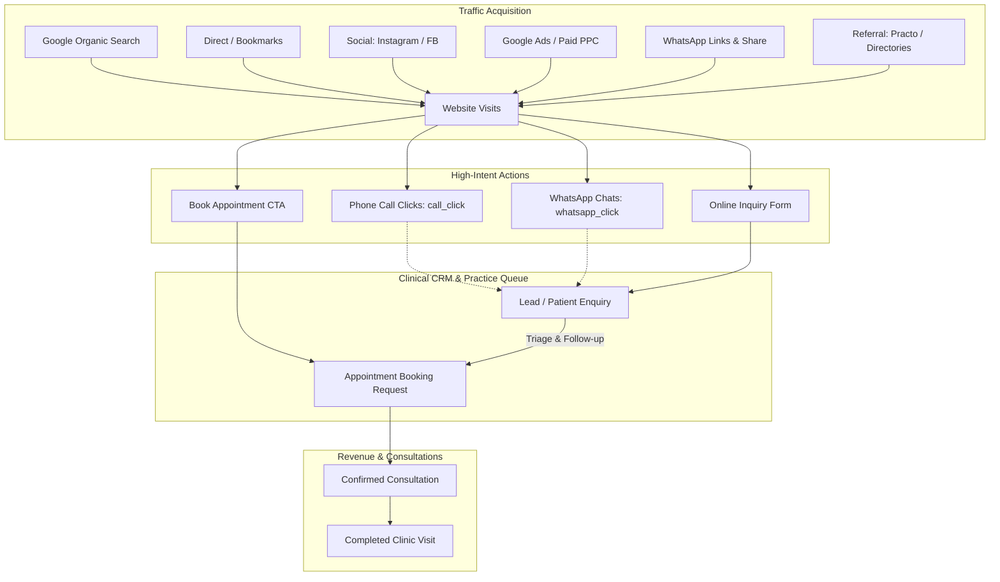
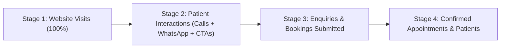

# ClinicRise Basic Practice Analytics API

This document details the tracking architecture, traffic acquisition classification, patient conversion funnels, and analytics endpoints in **ClinicRise**.

---

## 1. Healthcare Practice Analytics: Overview & Purpose

For clinical practices (dental clinics, polyclinics, hospitals, and specialty wellness centers), understanding where prospective patients come from and how they convert into booked consultations is essential for sustainable practice growth.

ClinicRise **Basic Analytics** continuously tracks and consolidates six vital dimensions into a single unified dashboard:

1. **Website Visits**: Total pageviews and unique visitors browsing the clinic's public website and custom domain.
2. **Traffic Sources**: Intelligent channel attribution (Google Organic Search, Direct Navigation, Social Media like Instagram/Facebook, Google Ads/Paid PPC, WhatsApp direct links, and External Healthcare Referrals like Practo).
3. **Calls**: Phone call button clicks (`call_click`) logged across doctor profiles, clinic contact headers, and treatment pages.
4. **WhatsApp Clicks**: WhatsApp chat initiation clicks (`whatsapp_click`) for patient inquiries.
5. **Enquiries**: Prospective patient inquiries / leads captured via web inquiry forms, callbacks, and intake channels.
6. **Bookings**: Confirmed and completed appointment bookings scheduled through the clinic booking engine.



---

## 2. Tracked Metrics & Data Model

### A. Traffic Channels & Taxonomy

ClinicRise automatically categorizes traffic into standard acquisition channels:

| Channel Identifier | Channel Label | Detection Rules |
| :--- | :--- | :--- |
| `organic_search` | **Organic Search** | Referrer matches search engines (`google.`, `bing.com`, `yahoo.`, `duckduckgo.com`, `ecosia.org`, `baidu.com`) with no paid parameters. |
| `direct` | **Direct Navigation** | No referrer header, bookmark access, or internal navigation within clinic subdomains. |
| `social` | **Social Media** | Referrer or `utm_medium` matches social networks (`instagram.com`, `facebook.com`, `twitter.com`, `t.co`, `x.com`, `linkedin.com`, `youtube.com`, `tiktok.com`, `threads.net`). |
| `paid_ad` | **Paid Ads / PPC** | Presence of `gclid`, `fbclid` (with paid context), or `utm_medium` in `['cpc', 'ppc', 'paid', 'paidsocial', 'display', 'search_ad']`. |
| `whatsapp` | **WhatsApp** | Referrer domain `wa.me`, `api.whatsapp.com`, `android-app://com.whatsapp`, or `utm_source=whatsapp`. |
| `referral` | **Referral Websites** | External websites (e.g., healthcare directories like Practo, Justdial, hospital affiliate sites). |
| `email` | **Email Campaigns** | `utm_medium=email` or webmail referrers (`mail.google.com`, `outlook.live.com`). |
| `campaign` | **Custom Campaigns** | Any link tagged with custom `utm_campaign` or `utm_source` not matching above. |

### B. Device & Technology Breakdown
- **Mobile Smartphone**: iOS Safari, Android Chrome, mobile webviews.
- **Desktop / Laptop**: Windows, macOS, Linux desktop browsers.
- **Tablet**: iPad, Android tablets.

---

## 3. The 4-Stage Patient Acquisition Funnel

ClinicRise visualizes practice conversion through a healthcare funnel:



1. **Stage 1: Website Visits**
   Total visitor traffic landing on the clinic's digital front door.
2. **Stage 2: High-Intent Actions (Calls & WhatsApp)**
   Visitors who took immediate action by tapping to call the clinic, starting a WhatsApp chat, or clicking the primary booking CTA.
3. **Stage 3: Enquiries & Bookings Submitted**
   Patients who submitted their contact information and healthcare inquiry or selected an appointment slot.
4. **Stage 4: Confirmed Appointments & Registered Patients**
   Bookings confirmed by clinic reception and inquiries converted to clinical consultations.

---

## 4. REST API Reference

### A. Public Website Visit Tracking (Beacon)
Record a visitor pageview from public clinic websites or custom domains:

- **URL**: `POST /api/analytics/public/<practice_slug_or_domain>/visit/`
- **Permission**: `AllowAny` (Public)
- **Request Body**:
```json
{
  "page_url": "https://citydental.clinicrise.com/treatments/implants",
  "page_path": "/treatments/implants",
  "page_title": "Dental Implants & Laser Dentistry | City Dental Care",
  "referrer": "https://www.google.com/search?q=dentist+near+me",
  "utm_source": "google",
  "utm_medium": "cpc",
  "utm_campaign": "diwali_smile_camp",
  "visitor_id": "vis_9823471-abc",
  "session_id": "sess_89123-xyz",
  "device_type": "mobile"
}
```

- **Response (201 Created)**:
```json
{
  "success": true,
  "visit_id": "9b1deb4d-3b7d-4bad-9bdd-2b0d7b3dcb6d",
  "traffic_channel": "paid_ad",
  "traffic_source": "google",
  "is_unique_daily": true,
  "message": "Website visit tracked successfully."
}
```

---

### B. Basic Analytics Dashboard Overview
Fetch consolidated KPI metrics, traffic sources, calls, WhatsApp clicks, enquiries, bookings, conversion funnel, and daily chart timeseries:

- **URL**: `GET /api/analytics/dashboard/` (or `GET /api/analytics/overview/`)
- **Headers**:
  - `Authorization: Bearer <access_token>`
  - `X-Practice-ID: <practice_uuid>`
- **Query Parameters**:
  - `preset`: `today` | `yesterday` | `7d` | `30d` (default) | `this_month` | `this_year`
  - `date_from`: `YYYY-MM-DD` (for custom range)
  - `date_to`: `YYYY-MM-DD` (for custom range)
  - `website_id`: `<uuid>` (optional: filter by specific website)

- **Response (200 OK)**:
```json
{
  "period": {
    "preset": "30d",
    "start": "2026-09-22T00:00:00+05:30",
    "end": "2026-10-21T09:47:20+05:30",
    "days": 30
  },
  "summary": {
    "website_visits": 1420,
    "unique_visitors": 980,
    "pageviews_per_visitor": 1.45,
    "calls": 86,
    "whatsapp_clicks": 142,
    "total_clicks": 284,
    "enquiries": 64,
    "unread_enquiries": 8,
    "bookings": 48,
    "confirmed_bookings": 38,
    "completed_bookings": 24
  },
  "growth_vs_previous_period": {
    "visits": 18.5,
    "calls": 12.0,
    "whatsapp_clicks": 28.4,
    "enquiries": 15.2,
    "bookings": 22.1
  },
  "traffic_sources": {
    "channels": {
      "organic_search": {
        "name": "Organic Search (Google, Bing, Yahoo)",
        "count": 680,
        "percentage": 47.89
      },
      "direct": {
        "name": "Direct / Typed URL",
        "count": 320,
        "percentage": 22.54
      },
      "social": {
        "name": "Social Media (Instagram, Facebook, LinkedIn, YouTube)",
        "count": 210,
        "percentage": 14.79
      },
      "paid_ad": {
        "name": "Paid Ads / Search Ads / PPC",
        "count": 120,
        "percentage": 8.45
      },
      "whatsapp": {
        "name": "WhatsApp Links & Chats",
        "count": 60,
        "percentage": 4.23
      },
      "referral": {
        "name": "Referral (External Websites)",
        "count": 30,
        "percentage": 2.11
      }
    },
    "top_sources": [
      { "source": "Google", "count": 680, "percentage": 47.89 },
      { "source": "Direct", "count": 320, "percentage": 22.54 },
      { "source": "Instagram", "count": 145, "percentage": 10.21 },
      { "source": "WhatsApp", "count": 60, "percentage": 4.23 },
      { "source": "Facebook", "count": 55, "percentage": 3.87 },
      { "source": "Practo", "count": 25, "percentage": 1.76 }
    ],
    "top_campaigns": [
      { "campaign": "diwali_smile_camp", "source": "google", "count": 82 },
      { "campaign": "dental_implants_promo", "source": "instagram", "count": 48 }
    ],
    "top_referrers": [
      { "domain": "www.google.com", "count": 680 },
      { "domain": "l.instagram.com", "count": 145 },
      { "domain": "www.practo.com", "count": 25 }
    ]
  },
  "calls_and_whatsapp": {
    "total_calls": 86,
    "total_whatsapp_clicks": 142,
    "total_booking_cta_clicks": 56,
    "total_directions_clicks": 28,
    "ratio_whatsapp_to_calls": 1.65
  },
  "enquiries": {
    "total": 64,
    "unread": 8,
    "conversion_rate_percentage": 34.38,
    "by_status": {
      "new": 8,
      "contacted": 18,
      "in_discussion": 14,
      "appointment_scheduled": 12,
      "converted": 22,
      "lost": 6,
      "junk": 2
    },
    "by_source": {
      "website_form": 32,
      "whatsapp_click": 20,
      "call_click": 8,
      "manual": 4
    }
  },
  "bookings": {
    "total": 48,
    "confirmed": 38,
    "completed": 24,
    "cancelled": 4,
    "pending": 6,
    "confirmation_rate_percentage": 79.17,
    "by_consultation_mode": {
      "in_person": 36,
      "video": 8,
      "phone": 4
    },
    "by_scheduling_mode": {
      "slot": 38,
      "token": 10
    }
  },
  "conversion_funnel": {
    "stages": [
      { "stage": 1, "name": "Website Visits", "count": 1420, "drop_off_percentage": 0.0 },
      { "stage": 2, "name": "High-Intent Actions (Calls & WhatsApp)", "count": 284, "conversion_from_visits_percentage": 20.0 },
      { "stage": 3, "name": "Enquiries & Bookings Submitted", "count": 112, "conversion_from_visits_percentage": 7.89 },
      { "stage": 4, "name": "Confirmed Appointments & Patients", "count": 60, "conversion_from_leads_percentage": 53.57, "overall_conversion_percentage": 4.23 }
    ],
    "conversion_rates": {
      "visit_to_interaction": 20.0,
      "visit_to_lead": 7.89,
      "lead_to_confirmed": 53.57,
      "overall_conversion": 4.23
    }
  },
  "device_breakdown": {
    "mobile": { "count": 1022, "percentage": 71.97 },
    "desktop": { "count": 355, "percentage": 25.0 },
    "tablet": { "count": 43, "percentage": 3.03 }
  },
  "top_pages": [
    { "path": "/", "title": "Home | City Dental Care", "visits": 710, "unique_visitors": 520 },
    { "path": "/treatments", "title": "Treatments & Services", "visits": 380, "unique_visitors": 290 },
    { "path": "/doctors", "title": "Our Doctors", "visits": 210, "unique_visitors": 180 },
    { "path": "/contact", "title": "Contact & Location", "visits": 120, "unique_visitors": 110 }
  ],
  "timeseries": [
    {
      "date": "2026-10-18",
      "visits": 48,
      "calls": 3,
      "whatsapp_clicks": 6,
      "enquiries": 2,
      "bookings": 2,
      "confirmed_bookings": 2
    },
    {
      "date": "2026-10-19",
      "visits": 54,
      "calls": 4,
      "whatsapp_clicks": 5,
      "enquiries": 3,
      "bookings": 2,
      "confirmed_bookings": 1
    },
    {
      "date": "2026-10-20",
      "visits": 62,
      "calls": 5,
      "whatsapp_clicks": 8,
      "enquiries": 4,
      "bookings": 3,
      "confirmed_bookings": 3
    }
  ]
}
```

---

### C. Granular Traffic Sources Endpoint
Get isolated traffic acquisition channels, campaigns, and referrers:

- **URL**: `GET /api/analytics/traffic-sources/`
- **Query Parameters**: Same presets (`today`, `7d`, `30d`, etc.)
- **Response (200 OK)**:
```json
{
  "period": { "preset": "30d", "start": "...", "end": "...", "days": 30 },
  "traffic_sources": {
    "channels": { ... },
    "top_sources": [ ... ],
    "top_campaigns": [ ... ],
    "top_referrers": [ ... ]
  },
  "device_breakdown": { ... }
}
```

---

### D. Conversion Funnel Endpoint
Dedicated endpoint for rendering funnel drop-offs and stage conversion charts:

- **URL**: `GET /api/analytics/funnel/`
- **Response (200 OK)**:
```json
{
  "period": { "preset": "30d", "start": "...", "end": "...", "days": 30 },
  "conversion_funnel": {
    "stages": [
      { "stage": 1, "name": "Website Visits", "count": 1420 },
      { "stage": 2, "name": "High-Intent Actions (Calls & WhatsApp)", "count": 284 },
      { "stage": 3, "name": "Enquiries & Bookings Submitted", "count": 112 },
      { "stage": 4, "name": "Confirmed Appointments & Patients", "count": 60 }
    ],
    "conversion_rates": {
      "visit_to_interaction": 20.0,
      "visit_to_lead": 7.89,
      "lead_to_confirmed": 53.57,
      "overall_conversion": 4.23
    }
  }
}
```

---

### E. Recent Visits & Page Log
List recent pageviews with device type and traffic channel filters:

- **URL**: `GET /api/analytics/visits/?channel=organic_search&device=mobile&limit=25`
- **Response (200 OK)**:
```json
{
  "total_count": 680,
  "results": [
    {
      "id": "58f12345-aaaa-bbbb-cccc-111122223333",
      "visitor_id": "vis_9823471",
      "page_url": "https://citydental.clinicrise.com/treatments/dental-implants",
      "page_path": "/treatments/dental-implants",
      "page_title": "Dental Implants",
      "referrer": "https://www.google.com/",
      "referrer_domain": "www.google.com",
      "traffic_channel": "organic_search",
      "traffic_channel_display": "Organic Search (Google, Bing, Yahoo)",
      "traffic_source": "Google",
      "device_type": "mobile",
      "device_type_display": "Mobile Smartphone",
      "is_unique_daily": true,
      "created_at": "2026-10-21T08:30:15Z"
    }
  ]
}
```

---

### F. Website-Scoped Analytics Endpoint
Direct route under the `websites` API for practice owners querying a specific website:

- **URL**: `GET /api/websites/<website_id>/analytics/`
- **Response (200 OK)**: Same full payload scoped to the targeted website.

---

## 5. Healthcare Privacy & Compliance

ClinicRise analytics adheres to strict healthcare privacy regulations (HIPAA, GDPR, DPDP Act 2023):
1. **No Protected Health Information (PHI) in Visit Logs**: Patient names, medical conditions, and prescriptions are never attached to raw visit logs.
2. **Anonymous Visitor Identifiers**: Visits use pseudonymous client-generated UUIDs (`visitor_id`) without intrusive third-party cross-site trackers.
3. **Multi-Tenant Isolation**: Every `WebsiteVisit` row is bound to `practice_id`. Cross-tenant queries are blocked at both database and serializer levels.
