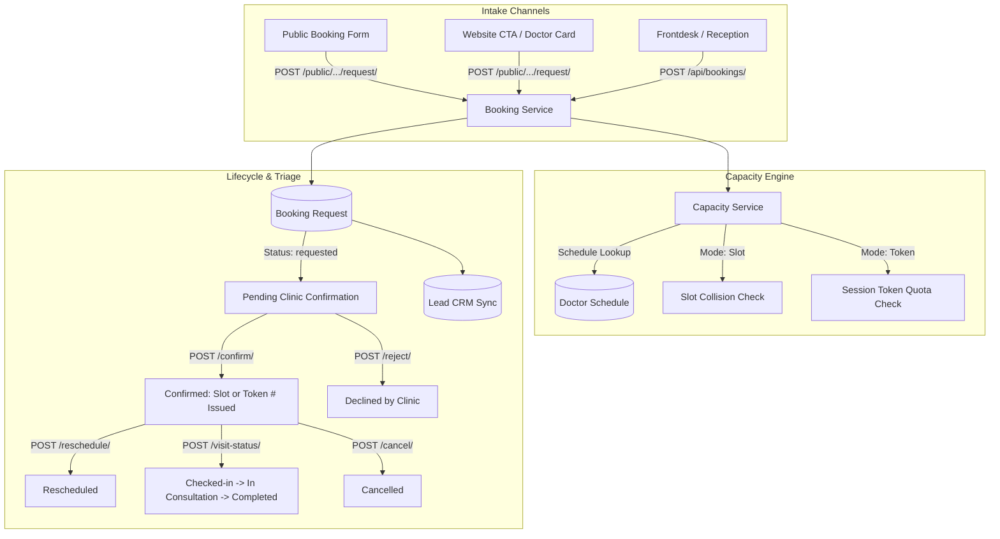

# ClinicRise Booking Requests & Queue Management API

This document details the multi-location scheduling architecture, patient booking preferences, dual scheduling modes (**Exact Time-Slot** vs. **Session/Token Queue**), capacity validation rules, and the clinic confirmation lifecycle in **ClinicRise**.

---

## 1. Architecture Overview

The **Booking Requests** engine manages patient appointment intake, clinical triage, doctor schedule enforcement, capacity validation, and clinic confirmations.



---

## 2. Multi-Location / Branch Support

Medical practices can configure multiple physical clinics, hospital OPD branches, and virtual teleconsultation facilities.

### Location Entity (`PracticeLocation`)
- `name`: Clinic branch name (e.g. *"Jubilee Hills Main Clinic"*, *"Gachibowli Branch"*).
- `code`: Short code (e.g. `JH-01`).
- `address`, `landmark`, `city`, `state`, `postal_code`, `country`.
- `phone_number`, `email`, `google_maps_url`.
- `is_telehealth_default`: Designates the virtual location for remote video calls.
- `is_primary`: Primary headquarters (guaranteed unique per practice).

---

## 3. Booking Preferences

Patients and receptionists can specify structured healthcare preferences:

| Preference Field | Options | Description |
| :--- | :--- | :--- |
| `consultation_mode` | `in_person`, `video`, `phone`, `home_visit` | Delivery channel for the medical consultation. |
| `preferred_date` | `YYYY-MM-DD` | Target date requested by the patient. |
| `preferred_time_window` | `morning`, `afternoon`, `evening`, `any` | Time window (e.g. Morning 9 AM - 12 PM, Evening 4 PM - 8 PM). |
| `location` | `UUID` | Selected clinic branch or telehealth facility. |
| `doctor` | `UUID` | Selected practitioner or medical specialist. |
| `service` | `UUID` | Requested procedure or consultation package. |
| `chief_complaint` | Text | Primary symptoms, pain description, or clinical reason. |
| `patient_notes` | Text | Accessibility requests, wheelchair assistance, language preference. |

---

## 4. Scheduling Modes: Time-Slot vs. Session/Token Mode

ClinicRise supports **both** appointment scheduling paradigms:

### A. Exact Time-Slot Mode (`booking_mode = 'slot'`)
- Traditional time-based booking (e.g. 10:15 AM - 10:30 AM).
- Doctors define consultation duration (e.g. 15, 30 mins) via `slot_duration_minutes`.
- Prevents overlapping bookings on the same doctor, date, and start time.

### B. Session / Token Mode (`booking_mode = 'token'`)
- High-volume outpatient clinic queue system (general medicine, pediatrics, hospital OPDs).
- Day is split into named OPD sessions: *"Morning OPD (09:00 - 13:00)"*, *"Evening OPD (17:00 - 20:30)"*.
- Patients receive a sequential queue number: `Token #1`, `Token #2`, `Token #15`.
- Stores `estimated_arrival_time` based on current token position.

---

## 5. Capacity Checks Engine

Before any booking request is accepted or confirmed, the `CapacityService` validates:

1. **Doctor Working Day Check**: Verifies that the doctor has an active `DoctorSchedule` on `appointment_date.weekday()`.
2. **Session Token Cap (`token` mode)**: Compares active bookings against `DoctorSessionCapacity.max_tokens_per_session`. If quota is reached, blocks confirmation with an informative message.
3. **Slot Collision Check (`slot` mode)**: Checks if the requested `start_time` is already booked for that doctor on that date (ignoring cancelled/rejected records).

---

## 6. Clinic Confirmation & Lifecycle Workflow

```
[ REQUESTED ] ──► (Clinic Confirmation) ──► [ CONFIRMED ]
      │                                            │
      ├────────────────────────┐                   ├──────────────► [ RESCHEDULED ]
      ▼                        ▼                   ▼
 [ REJECTED ]             [ CANCELLED ]     [ CHECKED IN ]
                                                   │
                                                   ▼
                                          [ IN CONSULTATION ]
                                                   │
                                                   ▼
                                             [ COMPLETED ]
```

---

## 7. API Endpoints Reference

### 7.1 Public Patient Endpoints

#### A. Submit Booking Request
- **URL**: `POST /api/bookings/public/<practice_slug_or_domain>/request/`
- **Request Body**:
```json
{
  "patient_name": "Meera Nambiar",
  "phone_number": "+919876512345",
  "email": "meera@gmail.com",
  "gender": "female",
  "age": 29,
  "location_id": "c1f714e8-8b92-4f3b-b234-98124b891234",
  "doctor_id": "d4e287a1-6c33-4f12-a199-873b88921100",
  "service_id": "f5a19283-7b11-4e89-bf88-12948bb301e2",
  "consultation_mode": "in_person",
  "preferred_date": "2026-10-28",
  "preferred_time_window": "morning",
  "booking_mode": "slot",
  "start_time": "10:15:00",
  "chief_complaint": "Severe tooth pain on lower left jaw.",
  "consent_given": true
}
```
- **Response (201 Created)**:
```json
{
  "success": true,
  "message": "Booking request received! Your reference is CR-202610-8F9A. The clinic will confirm your appointment shortly.",
  "booking_reference": "CR-202610-8F9A",
  "status": "requested",
  "status_display": "Pending Clinic Confirmation",
  "booking_mode": "slot",
  "appointment_date": "2026-10-28",
  "token_number": null,
  "start_time": "10:15",
  "clinic_name": "Apollo Dental Care"
}
```

---

#### B. Public Doctor Availability Inspector
Returns available OPD sessions (with token counters) and generated time-slots.
- **URL**: `GET /api/bookings/public/<practice_slug_or_domain>/availability/?doctor_id=<uuid>&date=2026-10-28`
- **Response (200 OK)**:
```json
{
  "date": "2026-10-28",
  "day_of_week": "Wednesday",
  "is_available": true,
  "sessions": [
    {
      "session_name": "Morning OPD",
      "start_time": "09:00",
      "end_time": "13:00",
      "current_tokens": 8,
      "max_tokens": 25,
      "remaining_tokens": 17,
      "is_full": false,
      "next_token": 9
    }
  ],
  "time_slots": [
    {
      "start_time": "09:00",
      "end_time": "09:15",
      "session_name": "Morning OPD",
      "is_available": true
    },
    {
      "start_time": "09:15",
      "end_time": "09:30",
      "session_name": "Morning OPD",
      "is_available": false
    }
  ]
}
```

---

#### C. Track Booking by Reference
- **URL**: `GET /api/bookings/public/<practice_slug_or_domain>/track/<booking_reference>/`
- **Response (200 OK)**: Booking details, token number / confirmed slot, doctor, and location info.

---

### 7.2 Authenticated Practice Endpoints

All authenticated requests require `Authorization: Bearer <token>` and `X-Practice-ID: <practice_uuid>`.

#### A. Locations Management
- `GET /api/bookings/locations/` &mdash; List branches.
- `POST /api/bookings/locations/` &mdash; Create a new clinic branch.
- `GET /api/bookings/locations/<id>/`, `PATCH`, `DELETE`.

#### B. Doctor Session Capacities
- `GET /api/bookings/capacities/` &mdash; List doctor session capacities.
- `POST /api/bookings/capacities/` &mdash; Configure max tokens, booking mode (`slot` vs `token`), and auto-confirm per doctor.

#### C. Appointment Dashboard & Booking Operations
- `GET /api/bookings/` &mdash; List & filter bookings (`status`, `doctor`, `location`, `date`, `mode`, `search`).
- `POST /api/bookings/` &mdash; Frontdesk walk-in / phone-in appointment booking.
- `GET /api/bookings/<id>/` &mdash; Detailed booking with audit timeline.
- `POST /api/bookings/<id>/confirm/` &mdash; **Clinic Confirmation**:
```json
{
  "confirmed_date": "2026-10-28",
  "start_time": "10:15:00",
  "end_time": "10:30:00",
  "clinic_notes": "Confirmed consultation with Dr. Rajesh Sharma."
}
```
*(In Token Mode, send: `{"confirmed_date": "2026-10-28", "session_name": "Morning OPD"}` to allocate the next sequential token).*

- `POST /api/bookings/<id>/reschedule/`:
```json
{
  "new_date": "2026-10-29",
  "new_start_time": "11:00:00",
  "reason": "Doctor in emergency surgery on Wednesday"
}
```
- `POST /api/bookings/<id>/cancel/`: `{"reason": "Patient called to cancel"}`
- `POST /api/bookings/<id>/reject/`: `{"reason": "Doctor on leave"}`
- `POST /api/bookings/<id>/visit-status/`: `{"status": "checked_in", "notes": "Patient waiting in lounge"}`
- `GET /api/bookings/stats/` &mdash; Today's queue counters, pending confirmation count, confirmed appointments.
