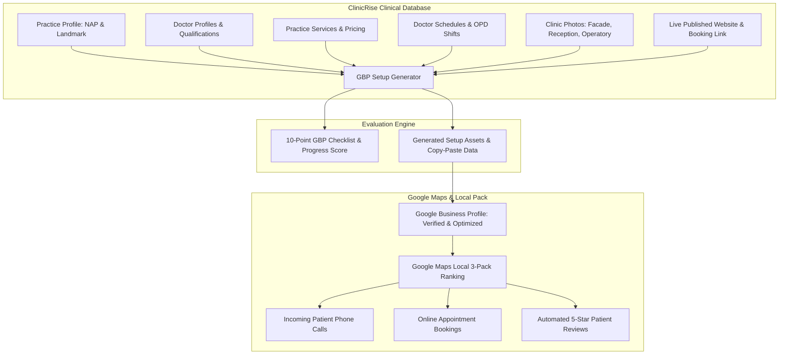

# ClinicRise Google Business Profile (GBP) Checklist & Setup API

This document details the local SEO architecture, 10-point Google Business Profile (GBP) audit checklist, dynamic progress evaluation, and automated setup asset generation in **ClinicRise**.

---

## 1. Local Healthcare SEO: Why Google Business Profile Matters

For over 80% of local patients, their healthcare discovery begins with a location-based Google search:
- *"Dentist near me"*
- *"Pediatrician in Jubilee Hills open now"*
- *"Best skin and dermatology clinic in Bangalore"*

When patients perform local healthcare searches, Google presents the **Local 3-Pack (Google Maps Showcase)** above standard organic search results. A complete, verified, and continuously optimized Google Business Profile is the single largest determinant of local patient acquisition, generating direct phone calls, map direction requests, and website appointment bookings.

ClinicRise bridges practice operations directly with Google Maps by providing:
1. **Real-time 10-Point Checklist Progress**: Evaluates clinic completeness, missing profile assets, and verification readiness.
2. **Auto-Generated Setup Information**: Formulates policy-compliant, SEO-crafted descriptions, primary/secondary healthcare categories, structured operating hours, services menus, and post-consultation 5-star review request templates.



---

## 2. The 10-Point GBP Healthcare Checklist

The checklist evaluates the clinic across four key operational dimensions:

| # | Checklist Item Key | Dimension | Criteria & Verification Rules | Priority |
| :---: | :--- | :--- | :--- | :---: |
| **1** | `business_name` | Profile Essentials | Official real-world clinic name matching exterior signage and licenses (no keyword stuffing). | **High** |
| **2** | `categories` | Profile Essentials | Primary category (e.g. *Dental Clinic*, *Medical Clinic*, *Doctor*) + relevant secondary specialties. | **High** |
| **3** | `location_address` | Profile Essentials | Exact physical address, door/suite number, landmark, city, and postal code. | **High** |
| **4** | `phone_and_contact` | Profile Essentials | Direct clinic phone line and dedicated WhatsApp patient number. | **High** |
| **5** | `operating_hours` | Patient Experience | Scheduled OPD consultation shifts, split hours (morning & evening), and weekend timings. | **High** |
| **6** | `website_and_appointment_links` | Patient Experience | Direct links to the clinic's published website and dedicated appointment booking engine. | **High** |
| **7** | `clinic_photos` | Visuals & Branding | Minimum 5 photos: exterior facade with signage, reception lounge, consultation desks, and equipment. | **Medium** |
| **8** | `services_menu` | Visuals & Branding | Procedure catalog with patient-friendly descriptions and transparent consultation fees. | **Medium** |
| **9** | `attributes_accessibility` | Patient Experience | Wheelchair accessibility, payment methods (UPI, Cards), and appointment policies. | **Medium** |
| **10** | `verification_and_reviews` | Reputation & Growth | Verified profile status on Google Maps and automated post-consultation 5-star review shortcut link. | **High** |

---

## 3. Generated Setup Assets

ClinicRise automatically synthesizes the following assets from the practice's live clinical database:

### A. Primary & Secondary Healthcare Categories
Google categories dictate map pack eligibility. ClinicRise maps practice types and clinical services to official Google categories:
- **Dental Practice**: Primary: `Dental Clinic`; Secondary: `Cosmetic Dentist`, `Orthodontist`, `Pediatric Dentist`, `Dental Implants Periodontist`, `Emergency Dental Service`.
- **Multispeciality Polyclinic**: Primary: `Medical Clinic`; Secondary: `General Practitioner`, `Pediatrician`, `Consultant Physician`, `Diagnostic Center`.
- **Diagnostic Center**: Primary: `Diagnostic Center`; Secondary: `Medical Diagnostic Imaging Center`, `Blood Testing Service`, `Pathology Laboratory`.

### B. 750-Character SEO Business Description
Crafted strictly within Google's 750-character limit, balancing doctor credentials, core specialties, sterilization protocols, and a clear call-to-action:
> *"Apollo Dental Care is a premier healthcare facility in Hyderabad, conveniently located near Metro Pillar 1400. Led by Dr. Rajesh Sharma (MDS Orthodontics, BDS), our team provides compassionate, evidence-based clinical care specializing in Dental Implants, Clear Teeth Aligners, and personalized treatment plans. We maintain strict sterilization standards, modern diagnostic technology, and comfortable outpatient facilities. Walk-ins and scheduled appointments welcome. Book online or call us today to schedule your consultation."*

### C. Standard Formatted NAP (Name, Address, Phone)
Clean multi-line and single-line address strings formatted to Google's indexing guidelines.

### D. Structured Operating Hours
Extracted from doctor schedules and converted into Google's split-shift syntax (e.g. `Monday: 09:00 - 13:00, 17:00 - 20:00; Tuesday: ...`).

### E. Services Catalog Payload
Pre-formatted list of active clinical procedures with name, category, pricing, and descriptions ready for Google's Services editor.

### F. Post-Consultation 5-Star Review Request Strategy
Direct review shortcut generator (`https://search.google.com/local/writereview?placeid=<place_id>`) with ready-to-send WhatsApp and SMS messaging templates for clinic receptionists.

### G. Welcome Launch Announcement Post
Ready-to-publish Google Business update introducing the clinic, medical team, shift timings, and direct booking button.

---

## 4. REST API Reference

### A. Fetch Checklist Progress
Retrieve the 10-point checklist progress, overall completion percentage, status badge, and top priority next steps:

- **URL**: `GET /api/gbp/checklist/`
- **Headers**:
  - `Authorization: Bearer <access_token>`
  - `X-Practice-ID: <practice_uuid>`
- **Response (200 OK)**:
```json
{
  "practice_id": "p1-uuid",
  "practice_name": "Apollo Dental Care",
  "progress": {
    "total_items": 10,
    "completed_items": 8,
    "completion_percentage": 80.0,
    "status_level": "Well Optimized (Minor Gaps)",
    "badge_color": "#3B82F6",
    "verification_status": "verified",
    "verification_status_display": "Verified & Active on Google Maps"
  },
  "checklist": [
    {
      "key": "business_name",
      "category": "Profile Essentials",
      "title": "Clinic Name & Branding",
      "description": "Accurate, official legal clinic name compliant with Google guidelines.",
      "is_completed": true,
      "priority": "high",
      "current_value": "Apollo Dental Care",
      "recommendation": "Use your real-world clinic signage name."
    },
    {
      "key": "clinic_photos",
      "category": "Visuals & Branding",
      "title": "High-Quality Clinic Photos (Min. 5)",
      "description": "Clear exterior building facade with signage, reception lounge, and equipment.",
      "is_completed": false,
      "priority": "medium",
      "current_value": "2 practice photos uploaded",
      "recommendation": "Upload at least 5 photos: exterior facade, reception, and doctor desk."
    }
  ],
  "next_priorities": [
    {
      "key": "clinic_photos",
      "title": "High-Quality Clinic Photos (Min. 5)",
      "action": "Upload at least 5 photos: exterior facade, reception, and doctor desk."
    }
  ]
}
```

---

### B. Update GBP Profile Configurations
Update Google Maps Place ID, verification state, primary category, or custom notes:

- **URL**: `PATCH /api/gbp/checklist/`
- **Permission**: `IsPracticeAdmin` (Owner or Admin)
- **Request Body**:
```json
{
  "google_maps_place_id": "ChIJ_apollo_hyd_123",
  "verification_status": "verified",
  "google_review_link": "https://g.page/r/apollo-dental-review/review",
  "primary_category": "Dental Clinic"
}
```
- **Response (200 OK)**: Updated `GBPProfileChecklist` representation.

---

### C. Toggle Manual Checklist Item
Manually check off an item verified outside the platform:

- **URL**: `POST /api/gbp/checklist/toggle/`
- **Request Body**:
```json
{
  "item_key": "clinic_photos",
  "is_completed": true
}
```
- **Response (200 OK)**:
```json
{
  "success": true,
  "item_key": "clinic_photos",
  "is_completed": true,
  "progress": {
    "total_items": 10,
    "completed_items": 9,
    "completion_percentage": 90.0,
    "status_level": "Well Optimized (Minor Gaps)"
  }
}
```

---

### D. Generated Setup Information
Generate copy-pasteable assets and metadata for setting up or updating Google Business Profile:

- **URL**: `GET /api/gbp/setup-info/`
- **Headers**:
  - `Authorization: Bearer <access_token>`
  - `X-Practice-ID: <practice_uuid>`
- **Response (200 OK)**:
```json
{
  "business_identity": {
    "business_name": "Apollo Dental Care",
    "primary_category": "Dental Clinic",
    "secondary_categories": [
      "Cosmetic Dentist",
      "Dental Implants Periodontist",
      "Emergency Dental Service",
      "Orthodontist",
      "Pediatric Dentist"
    ],
    "clinic_type": "dental_clinic"
  },
  "seo_description": {
    "text": "Apollo Dental Care is a premier healthcare facility in Hyderabad, conveniently located near Metro Pillar 1400. Led by Dr. Rajesh Sharma (MDS Orthodontics, BDS), our team provides compassionate, evidence-based clinical care specializing in Dental Implants, Clear Teeth Aligners and personalized treatment plans...",
    "character_count": 682,
    "max_limit": 750
  },
  "nap_contact": {
    "business_name": "Apollo Dental Care",
    "phone_number": "+919876543210",
    "whatsapp_number": "+919876543210",
    "email": "contact@apollodental.com",
    "single_line_address": "Plot 42, Road No. 36, Jubilee Hills, Near Metro Pillar 1400, Hyderabad, Telangana, PIN: 500033, India",
    "street_address": "Plot 42, Road No. 36, Jubilee Hills",
    "landmark": "Near Metro Pillar 1400",
    "city": "Hyderabad",
    "state": "Telangana",
    "postal_code": "500033",
    "country": "India",
    "google_maps_url": "https://maps.google.com/?q=Apollo+Dental+Care+Hyderabad",
    "google_maps_place_id": "ChIJ_apollo_hyd_123"
  },
  "online_links": {
    "website_url": "https://apollodental.clinicrise.com",
    "appointment_booking_url": "https://apollodental.clinicrise.com#appointment",
    "google_review_url": "https://search.google.com/local/writereview?placeid=ChIJ_apollo_hyd_123"
  },
  "operating_hours": {
    "summary": "Monday: 09:00 - 13:00, 17:00 - 20:00; Tuesday: 09:00 - 13:00...",
    "periods": [
      { "day": "Monday", "open": "09:00", "close": "13:00", "shift": "Morning OPD" },
      { "day": "Monday", "open": "17:00", "close": "20:00", "shift": "Evening OPD" }
    ]
  },
  "services_catalog": [
    {
      "name": "Dental Implants",
      "category": "Dental Procedure",
      "price": "INR 25000",
      "description": "Titanium root replacement and premium porcelain crown restoration."
    },
    {
      "name": "Clear Teeth Aligners",
      "category": "Orthodontics",
      "price": "INR 45000",
      "description": "Invisible braces for teeth straightening."
    }
  ],
  "attributes": {
    "has_wheelchair_accessible_entrance": true,
    "has_wheelchair_accessible_restroom": true,
    "requires_appointments": true,
    "accepts_upi_payments": true,
    "accepts_credit_cards": true
  },
  "review_strategy": {
    "review_url": "https://search.google.com/local/writereview?placeid=ChIJ_apollo_hyd_123",
    "whatsapp_template": "Dear Patient, thank you for visiting Apollo Dental Care! We hope your consultation with Dr. Rajesh Sharma was pleasant. Could you take 30 seconds to share your feedback on Google? It helps others find trusted care:\nhttps://search.google.com/local/writereview?placeid=ChIJ_apollo_hyd_123\n— Team Apollo Dental Care",
    "sms_template": "Thank you for choosing Apollo Dental Care. Please share your review on Google: https://search.google.com/local/writereview?placeid=ChIJ_apollo_hyd_123"
  },
  "welcome_post": {
    "title": "Welcome to Apollo Dental Care - Quality Healthcare in Hyderabad",
    "body": "We are proud to serve the community in Hyderabad with advanced medical care! Led by experienced practitioners, Apollo Dental Care offers specialized treatments including Dental Implants, Clear Teeth Aligners...",
    "call_to_action": "BOOK",
    "cta_url": "https://apollodental.clinicrise.com#appointment"
  },
  "photos_guide": [
    { "type": "Exterior Signage", "recommendation": "Building exterior showing main entrance and clinic name board during daylight." },
    { "type": "Reception & Waiting Area", "recommendation": "Clean, welcoming patient seating lounge and frontdesk." },
    { "type": "Consultation Room", "recommendation": "Doctor consultation chamber, desk, and clinical examination couch." },
    { "type": "Medical Equipment", "recommendation": "Modern diagnostics, dental chairs, or advanced treatment machinery." },
    { "type": "Team Portrait", "recommendation": "Doctors and nursing/reception staff in professional clinical attire." }
  ]
}
```

---

### E. Quick Review Shortcut for Receptionists
Direct endpoint for frontdesk staff to fetch the patient review shortcut link and pre-written message templates:

- **URL**: `GET /api/gbp/review-link/`
- **Response (200 OK)**:
```json
{
  "review_url": "https://search.google.com/local/writereview?placeid=ChIJ_apollo_hyd_123",
  "whatsapp_template": "Dear Patient, thank you for visiting Apollo Dental Care! ...",
  "sms_template": "Thank you for choosing Apollo Dental Care. Please share your review on Google: ..."
}
```
