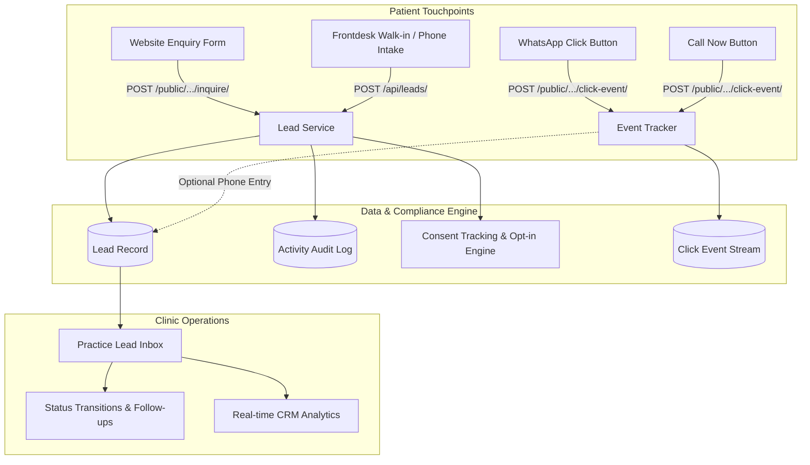

# ClinicRise Leads & Enquiries CRM API

This document details the architecture, data models, endpoints, and workflows for **Leads & Enquiries**, **Call and WhatsApp Click Tracking**, **Lead Inbox**, **Pipeline Status Transitions**, and **Consent / Privacy Compliance** in **ClinicRise**.

---

## 1. Architecture Overview

The Leads and Enquiries module serves as the primary patient acquisition and CRM engine for clinics on ClinicRise. It captures patient intent across multiple touchpoints, tracks explicit compliance consent, and provides a multi-tenant inbox for clinic receptionists, doctors, and practice administrators.



### Key Pillars
1. **Multi-Tenant Isolation**: Leads are strictly bound to a `Practice` tenant (`TenantAwareModel`). Clinic staff access leads scoped to their active practice using the `X-Practice-ID` header.
2. **Channel-Specific Consent**: Captures explicit consent timestamp, IP address, user agent, disclosure text, and granular channel opt-ins (`whatsapp_opt_in`, `call_opt_in`, `sms_opt_in`, `email_opt_in`), with immediate withdrawal capabilities.
3. **High-Intent Click Tracking**: Dedicated tracking for "Click to WhatsApp" and "Click to Call" buttons with full UTM marketing attribution.
4. **Audit Trail**: Every status transition, note, phone call, and consent change is permanently recorded in `LeadActivity`.

---

## 2. Lead Status Pipeline & Workflow

```
[ NEW / UNCONTACTED ] 
         │
         ▼
    [ CONTACTED ] 
         │
         ├───────────────────────────────┐
         ▼                               ▼
 [ IN DISCUSSION ]             [ LOST / NOT INTERESTED ]
         │
         ▼
[ APPOINTMENT SCHEDULED ]
         │
         ▼
    [ CONVERTED ]
```

| Status Code | Label | Description |
| :--- | :--- | :--- |
| `new` | New / Uncontacted | Fresh inquiry received via website, WhatsApp, call, or ad campaign. Unread badge displayed. |
| `contacted` | Contacted | Staff or practitioner has reached out to the patient via phone, WhatsApp, or email. |
| `in_discussion` | In Discussion | Patient is exploring procedure options, packages, doctor availability, or pricing. |
| `appointment_scheduled` | Appointment Scheduled | Consultation or clinic visit date and time confirmed. |
| `converted` | Converted | Patient attended appointment, completed treatment, or enrolled. |
| `lost` | Lost / Not Interested | Lead declined treatment, selected competitor, or ceased contact (stores `lost_reason`). |
| `junk` | Junk / Spam | Test submission, invalid phone number, or commercial spam. |

---

## 3. Consent & Healthcare Compliance (GDPR, India DPDP, HIPAA)

Every lead stores verifiable proof of communication consent:
- `consent_given`: Explicit boolean declaration.
- `consent_timestamp`: UTC timestamp when consent was captured.
- `consent_text`: Exact disclosure terms presented on the form or CTA modal.
- `consent_ip_address` & `user_agent`: Technical audit trail.
- Channel toggles: `whatsapp_opt_in`, `call_opt_in`, `sms_opt_in`, `email_opt_in`.
- `consent_withdrawn` & `consent_withdrawn_at`: When revoked, marketing & automated reminders are immediately blocked.

---

## 4. API Endpoints

### 4.1 Public Patient Endpoints (No Auth Required)

#### A. Submit Website Enquiry Form
Captures consultation or booking requests submitted by prospective patients.
- **URL**: `POST /api/leads/public/<practice_slug_or_domain>/inquire/`
- **Identifier**: Can be Practice slug (`sunrise-clinic-hyd`), custom domain (`www.sunriseclinic.com`), or website subdomain (`sunrise`).
- **Request Body**:
```json
{
  "patient_name": "Kavita Rao",
  "phone_number": "+919876511111",
  "email": "kavita.rao@gmail.com",
  "preferred_date": "2026-10-25",
  "preferred_time_slot": "Morning (10:00 AM - 12:00 PM)",
  "service_requested": "Root Canal Consultation",
  "doctor_requested": "Dr. Rajesh Sharma",
  "message": "Experiencing tooth pain on right lower jaw.",
  "consent_given": true,
  "consent_text": "I agree to receive communications regarding my enquiry via Phone, WhatsApp, SMS and Email.",
  "whatsapp_opt_in": true,
  "call_opt_in": true,
  "sms_opt_in": true,
  "email_opt_in": true,
  "utm_source": "google_ads",
  "utm_medium": "cpc",
  "utm_campaign": "dental_implants_hyd",
  "source_url": "https://sunrise.clinicrise.com/services/root-canal",
  "device_type": "mobile"
}
```
- **Response (201 Created)**:
```json
{
  "success": true,
  "message": "Thank you! Your enquiry has been received by Sunrise Multispeciality Clinic. A representative will contact you shortly.",
  "lead_id": "c8b417ef-7b3b-4176-96b6-8e504c568ec5",
  "clinic_name": "Sunrise Multispeciality Clinic",
  "consent_recorded": true
}
```

---

#### B. Track Call & WhatsApp Click Events
Records clicks on "Call Now", "Chat on WhatsApp", or appointment CTAs.
- **URL**: `POST /api/leads/public/<practice_slug_or_domain>/click-event/`
- **Request Body**:
```json
{
  "event_type": "whatsapp_click",
  "target_phone": "+919876543210",
  "doctor_name": "Dr. Rajesh Sharma",
  "service_name": "Dental Implants",
  "page_url": "https://sunrise.clinicrise.com/doctors/dr-rajesh",
  "utm_source": "instagram",
  "utm_medium": "bio_link",
  "device_type": "mobile",
  "visitor_id": "anon_vis_9823471"
}
```
- **Response (201 Created)**:
```json
{
  "success": true,
  "event_id": "5fa23d11-19ce-4279-bf73-9844bb301e51",
  "event_type": "whatsapp_click",
  "lead_id": null,
  "message": "Click event recorded successfully."
}
```
*(If `phone_number` and `patient_name` are passed in the request body, a high-priority Lead is automatically created and linked to the ClickEvent).*

---

#### C. Public Patient Consent Opt-Out / Unsubscribe
Allows patients to withdraw communication consent at any time.
- **URL**: `POST /api/leads/public/<practice_slug_or_domain>/opt-out/`
- **Request Body**:
```json
{
  "phone_number": "+919876511111",
  "reason": "Unsubscribe request via web form"
}
```
- **Response (200 OK)**:
```json
{
  "success": true,
  "message": "Consent successfully withdrawn for +919876511111. You will no longer receive communications from Sunrise Multispeciality Clinic.",
  "records_updated": 1
}
```

---

### 4.2 Authenticated CRM & Lead Inbox Endpoints

All authenticated requests require `Authorization: Bearer <token>` and `X-Practice-ID: <practice_uuid>`.

#### A. List & Filter Leads (Lead Inbox)
- **URL**: `GET /api/leads/inbox/` (or `GET /api/leads/`)
- **Query Parameters**:
  - `status`: Filter by status (`new`, `contacted`, `in_discussion`, `appointment_scheduled`, `converted`, `lost`, `junk`). Comma-separated for multiple.
  - `source`: Filter by origin (`website_form`, `whatsapp_click`, `call_click`, `manual`, `campaign`, `referral`).
  - `priority`: `low`, `medium`, `high`, `urgent`.
  - `is_read`: `true` or `false`.
  - `assigned_to`: UUID of staff user.
  - `search`: Search across patient name, phone, email, requested service, doctor, and complaint.
  - `date_from`, `date_to`: ISO date strings.
  - `ordering`: `-created_at`, `created_at`, `status`, `priority`, `follow_up_date`.
- **Response (200 OK)**:
```json
[
  {
    "id": "c8b417ef-7b3b-4176-96b6-8e504c568ec5",
    "patient_name": "Kavita Rao",
    "phone_number": "+919876511111",
    "email": "kavita.rao@gmail.com",
    "preferred_date": "2026-10-25",
    "preferred_time_slot": "Morning (10:00 AM - 12:00 PM)",
    "service_requested": "Root Canal Consultation",
    "doctor_requested": "Dr. Rajesh Sharma",
    "message": "Experiencing tooth pain on right lower jaw.",
    "status": "new",
    "status_display": "New / Uncontacted",
    "priority": "medium",
    "priority_display": "Medium",
    "source": "website_form",
    "source_display": "Website Enquiry Form",
    "is_read": false,
    "assigned_to": null,
    "assigned_to_name": null,
    "last_contacted_at": null,
    "follow_up_date": null,
    "activities_count": 1,
    "consent_given": true,
    "whatsapp_opt_in": true,
    "call_opt_in": true,
    "sms_opt_in": true,
    "email_opt_in": true,
    "consent_withdrawn": false,
    "created_at": "2026-10-18T15:20:00Z",
    "updated_at": "2026-10-18T15:20:00Z"
  }
]
```

---

#### B. Manually Log a Lead (Reception / Frontdesk)
- **URL**: `POST /api/leads/`
- **Request Body**:
```json
{
  "patient_name": "Manish Sharma",
  "phone_number": "+919876577777",
  "email": "manish@sharma.in",
  "service_requested": "Orthodontic Evaluation",
  "priority": "high",
  "source": "manual",
  "message": "Walk-in patient at front desk inquiring about ceramic braces.",
  "consent_given": true,
  "whatsapp_opt_in": true,
  "call_opt_in": true
}
```
- **Response (201 Created)**: Full Lead detail object with initial audit activity.

---

#### C. Get Lead Details & Timeline
Automatically marks `is_read=true` upon retrieval.
- **URL**: `GET /api/leads/<id>/`
- **Response (200 OK)**:
```json
{
  "id": "c8b417ef-7b3b-4176-96b6-8e504c568ec5",
  "patient_name": "Kavita Rao",
  "phone_number": "+919876511111",
  "email": "kavita.rao@gmail.com",
  "status": "new",
  "is_read": true,
  "source": "website_form",
  "utm_source": "google_ads",
  "utm_campaign": "dental_implants_hyd",
  "consent_given": true,
  "consent_timestamp": "2026-10-18T15:20:00Z",
  "consent_text": "I agree to receive communications regarding my enquiry via Phone, WhatsApp, SMS and Email.",
  "whatsapp_opt_in": true,
  "activities": [
    {
      "id": "71398864-d621-4d37-97d2-43bb58913da6",
      "activity_type": "status_change",
      "activity_type_display": "Status Changed",
      "performed_by": null,
      "performed_by_name": "System / Public",
      "previous_status": "",
      "new_status": "new",
      "note": "Enquiry form submitted by Kavita Rao via Sunrise Multispeciality Clinic.",
      "created_at": "2026-10-18T15:20:00Z"
    }
  ],
  "click_events": []
}
```

---

#### D. Update Lead Status (Pipeline Transition)
- **URL**: `POST /api/leads/<id>/status/`
- **Request Body**:
```json
{
  "status": "appointment_scheduled",
  "note": "Booked root canal appointment for Saturday 11am with Dr. Rajesh.",
  "follow_up_date": "2026-10-24T11:00:00Z"
}
```
- **Response (200 OK)**: Updated lead object. Automatically logs a `status_change` activity and updates `last_contacted_at`.

---

#### E. Add Staff Timeline Note or Log Call
- **URL**: `POST /api/leads/<id>/activities/`
- **Request Body**:
```json
{
  "activity_type": "call_logged",
  "note": "Called patient to confirm medical history. Patient confirmed no allergies.",
  "metadata": {
    "call_duration_seconds": 120,
    "call_outcome": "answered"
  }
}
```
- **Response (201 Created)**:
```json
{
  "id": "902d182e-9dcb-49da-9c86-13d8001beff4",
  "activity_type": "call_logged",
  "activity_type_display": "Phone Call Logged",
  "performed_by": "e2a1498b-7032-4752-9a3b-b27b9c9f0ef1",
  "performed_by_name": "Pooja Reddy",
  "note": "Called patient to confirm medical history. Patient confirmed no allergies.",
  "created_at": "2026-10-18T15:25:00Z"
}
```

---

#### F. Update Consent Preferences & Revocation
- **URL**: `POST /api/leads/<id>/consent/`
- **Request Body (Withdraw Consent)**:
```json
{
  "consent_withdrawn": true,
  "consent_withdrawn_reason": "Patient requested no more promotional messages"
}
```
*(Or send granular preferences: `{"whatsapp_opt_in": false, "call_opt_in": true}`)*
- **Response (200 OK)**: Updated lead object with logged `consent_updated` activity.

---

#### G. CRM Analytics & Inbox Stats
- **URL**: `GET /api/leads/stats/`
- **Response (200 OK)**:
```json
{
  "total_leads": 128,
  "unread_count": 14,
  "conversion_rate_percentage": 28.12,
  "pipeline": {
    "new": 14,
    "contacted": 32,
    "in_discussion": 26,
    "appointment_scheduled": 18,
    "converted": 36,
    "lost": 12,
    "junk": 6
  },
  "time_stats": {
    "today": 8,
    "this_week": 41,
    "this_month": 128
  },
  "source_breakdown": {
    "website_form": 64,
    "whatsapp_click": 38,
    "call_click": 16,
    "manual": 6,
    "campaign": 4,
    "referral": 0,
    "other": 0
  },
  "click_events": {
    "total_call_clicks": 42,
    "total_whatsapp_clicks": 97,
    "total_clicks_today": 15
  }
}
```

---

#### H. Call & WhatsApp Click Event Log
- **URL**: `GET /api/leads/events/?event_type=whatsapp_click`
- **Response (200 OK)**: Array of `ClickEvent` records with attribution details.
