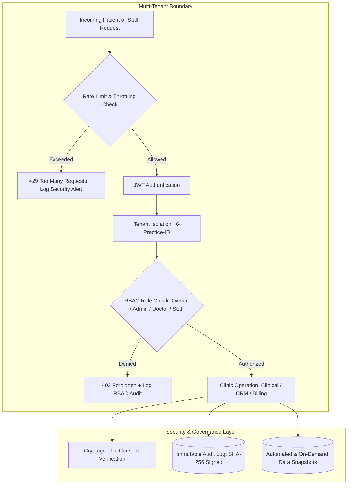

# ClinicRise Security, Compliance & Audit API

This document details the multi-tenant healthcare security architecture, Role-Based Access Control (RBAC), cryptographic patient consent management, compliance audit logging, rate limiting, and disaster recovery backup systems in **ClinicRise**.

---

## 1. Security Architecture & Healthcare Compliance

Healthcare platforms handle sensitive Protected Health Information (PHI) and financial transactions. ClinicRise is engineered to comply with major healthcare privacy and data protection frameworks including:
- **Digital Personal Data Protection Act (DPDP Act 2023 - India)**
- **Health Insurance Portability and Accountability Act (HIPAA - USA)**
- **General Data Protection Regulation (GDPR - EU)**



---

## 2. Role-Based Access Control (RBAC) Matrix

ClinicRise enforces strict role segregation across four tiers of clinic team members:

| Action / Capability | Practice Owner (`owner`) | Practice Admin (`admin`) | Doctor / Practitioner (`doctor`) | Frontdesk / Staff (`staff`) |
| :--- | :---: | :---: | :---: | :---: |
| **Manage Subscription & Billing** | ✅ Full Access | ❌ No Access | ❌ No Access | ❌ No Access |
| **Delete / Transfer Practice** | ✅ Exclusive | ❌ No Access | ❌ No Access | ❌ No Access |
| **Download Data Backups** | ✅ Exclusive | ❌ No Access | ❌ No Access | ❌ No Access |
| **Generate & Verify Backups** | ✅ Full Access | ✅ Full Access | ❌ No Access | ❌ No Access |
| **View Security Audit Logs** | ✅ Full Access | ✅ Full Access | ❌ No Access | ❌ No Access |
| **Manage Team Roles & Invites** | ✅ Full Access | ✅ Full Access | ❌ No Access | ❌ No Access |
| **Approve Clinical Web Content** | ✅ Full Access | ✅ Full Access | ✅ Medical Sign-off | ❌ Blocked (403) |
| **Prescribe & Add Clinical Notes** | ✅ Full Access | ❌ No Access | ✅ Full Access | ❌ No Access |
| **Patient Intake & Lead Inbox** | ✅ Full Access | ✅ Full Access | ✅ Assigned Only | ✅ Full Access |
| **Schedule Bookings & Queue** | ✅ Full Access | ✅ Full Access | ✅ Full Access | ✅ Full Access |
| **Record & Revoke Patient Consent** | ✅ Full Access | ✅ Full Access | ✅ Full Access | ✅ Full Access |

---

## 3. Cryptographic Patient Consent Governance

Under healthcare compliance regulations, clinics must maintain verifiable proof of patient consent before initiating communications or performing medical procedures.

### Consent Categories
1. `teleconsultation`: Telemedicine video consultation and clinical audio/video recording.
2. `treatment_procedure`: Informed consent for in-person medical/dental procedures or day surgery.
3. `marketing`: Health tips, promotional campaigns, and clinic newsletters.
4. `records_sharing`: Transmission of electronic medical records (EMR) to external diagnostic labs or specialists.
5. `whatsapp_notifications`: Direct appointment reminders, prescriptions, and care instructions via WhatsApp.
6. `sms_notifications`: SMS notifications for appointment confirmations and tokens.
7. `general_intake`: Standard clinic registration and privacy disclosures.

### SHA-256 Audit Signature
Every `ConsentRecord` calculates an immutable SHA-256 cryptographic hash over the patient identifier, practice ID, consent type, version, exact disclosure text, and timestamp:
$$\text{Audit Hash} = \text{SHA-256}(\text{PracticeID} : \text{PatientID} : \text{Type} : \text{Version} : \text{DisclosureText} : \text{Timestamp})$$

This cryptographic proof ensures that consent terms cannot be altered retroactively by either party.

---

## 4. Compliance Audit Trail

ClinicRise records all security, privacy, administrative, and clinical events in the `AuditLog` table:

- **Categories**:
  - `auth`: Logins, logouts, failed authentication attempts, OTP requests.
  - `rbac`: Role changes, team member invitations, account deactivations.
  - `patient_privacy`: PHI views, patient medical history access, health data exports.
  - `consent`: Consent agreements granted, renewed, or revoked.
  - `clinical`: Medical blog approvals, treatment edits, clinical notes.
  - `billing`: Invoice payments, subscription upgrades/downgrades.
  - `backup`: Database backup creation, integrity verification, and archive downloads.
  - `security`: Rate-limit violations, anomalous IP activity, token invalidation.

- **Severity Levels**:
  - `info`: Routine operations (e.g. user login, booking confirmation).
  - `warning`: Sensitive actions (e.g. role update, consent revocation, backup download, rate limit exceeded).
  - `critical`: High-priority security alarms (e.g. brute force authentication flood, unauthorized PHI export attempt).

---

## 5. Rate Limits & Abuse Mitigation

To protect clinical systems from brute-force attacks, OTP exhaustion, and Denial of Service (DoS), ClinicRise enforces layered throttling:

| Scope | Default Rate | Target Endpoints | Action on Limit Exceeded |
| :--- | :--- | :--- | :--- |
| `auth_attempt` | **5 / minute** | `POST /api/auth/otp/send/`, `POST /api/auth/otp/verify/` | HTTP 429 + Logs `security.rate_limited` audit event |
| `public_inquiry` | **10 / minute** | `POST /api/leads/public/.../inquire/`, `POST /api/bookings/public/.../request/` | HTTP 429 (Blocks spam bots) |
| `analytics_beacon` | **120 / minute** | `POST /api/analytics/public/.../visit/`, click events | HTTP 429 (Telemetry flood protection) |
| `backup_export` | **5 / hour** | `POST /api/security/backups/`, backup downloads | HTTP 429 (Server CPU / I/O protection) |
| `anon` | **500 / day** | All unauthenticated public endpoints | HTTP 429 |
| `user` | **2,000 / day** | All authenticated staff/doctor endpoints | HTTP 429 |

---

## 6. Disaster Recovery & Backups

ClinicRise enables Practice Owners and Administrators to generate cryptographically verified snapshots of their complete practice dataset:

### Snapshot Contents
- Clinic profile, settings, and multi-location branches
- Medical treatments, service menus, and practitioner profiles
- Published and draft website pages, SEO metadata, and medical blogs
- Patient leads, inquiry notes, and communications history
- Appointment booking requests and queue timelines
- Cryptographic consent records and audit trails

### Integrity & Verification
- Every backup produces a `SHA-256` checksum stored alongside the archive.
- `POST /api/security/backups/<id>/verify/`: Re-reads archive from storage, re-computes the checksum, and validates the internal JSON schema to confirm zero corruption.
- **Strict Role Gating**: Backup generation is accessible to `admin` and `owner`. Downloading the full patient archive is restricted **exclusively to the Practice Owner (`owner`)**.

---

## 7. REST API Reference

### A. Role Checks & Permissions

#### 1. Current User Permissions
- **URL**: `GET /api/security/roles/my-permissions/`
- **Headers**:
  - `Authorization: Bearer <access_token>`
  - `X-Practice-ID: <practice_uuid>`
- **Response (200 OK)**:
```json
{
  "user_id": "u1-uuid",
  "email": "dr.vikram@cityclinic.com",
  "practice_id": "p1-uuid",
  "practice_name": "City Health Clinic",
  "role": "owner",
  "role_display": "Practice Owner",
  "capabilities": {
    "can_manage_billing": true,
    "can_manage_backups": true,
    "can_view_audit_logs": true,
    "can_manage_roles": true,
    "can_approve_clinical_content": true,
    "can_record_consent": true,
    "can_view_leads_and_bookings": true
  }
}
```

#### 2. Practice Team Roles Overview
- **URL**: `GET /api/security/roles/`
- **Permission**: `IsPracticeAdmin` (Owner or Admin)
- **Response (200 OK)**: Array of team members with assigned roles.

---

### B. Compliance Audit Logs

#### 1. Query Audit Trail
- **URL**: `GET /api/security/audit-logs/?category=patient_privacy&severity=warning&limit=25`
- **Permission**: `IsPracticeAdmin`
- **Response (200 OK)**:
```json
{
  "total_count": 42,
  "results": [
    {
      "id": "a1-uuid",
      "actor": "u2-uuid",
      "actor_email": "admin@cityclinic.com",
      "actor_role": "admin",
      "category": "patient_privacy",
      "category_display": "Patient Privacy & PHI Access",
      "action": "patient_privacy.exported",
      "severity": "warning",
      "severity_display": "Security Warning",
      "target_model": "PatientRecord",
      "target_id": "rec-123",
      "target_repr": "Patient Anita Rao",
      "description": "Patient health records exported for insurance claim.",
      "changes": { "format": "pdf", "records_exported": 5 },
      "ip_address": "49.207.180.12",
      "user_agent": "Mozilla/5.0 ... Chrome/114",
      "created_at": "2026-10-21T09:15:00Z"
    }
  ]
}
```

#### 2. Audit Log Detail
- **URL**: `GET /api/security/audit-logs/<uuid:pk>/`
- **Response (200 OK)**: Full audit record with state diffs.

---

### C. Patient Consent Records

#### 1. Record Patient Consent
- **URL**: `POST /api/security/consents/`
- **Request Body**:
```json
{
  "patient_identifier": "+919988776655",
  "patient_name": "Meera Patel",
  "consent_type": "teleconsultation",
  "consent_text": "I agree to remote video consultation and secure medical audio/video recording.",
  "version": "1.2"
}
```
- **Response (201 Created)**:
```json
{
  "id": "c1-uuid",
  "patient_identifier": "+919988776655",
  "patient_name": "Meera Patel",
  "consent_type": "teleconsultation",
  "consent_type_display": "Telemedicine & Video Consultation Recording",
  "status": "granted",
  "status_display": "Granted / Active",
  "version": "1.2",
  "audit_hash": "e3b0c44298fc1c149afbf4c8996fb92427ae41e4649b934ca495991b7852b855",
  "granted_at": "2026-10-21T10:00:00Z"
}
```

#### 2. Verify Consent Status
- **URL**: `GET /api/security/consents/check/?patient=+919988776655&type=whatsapp_notifications`
- **Response (200 OK)**:
```json
{
  "patient_identifier": "+919988776655",
  "consent_type": "whatsapp_notifications",
  "has_active_consent": true
}
```

#### 3. Withdraw Consent (Opt-Out)
- **URL**: `POST /api/security/consents/withdraw/`
- **Request Body**:
```json
{
  "patient_identifier": "+919988776655",
  "consent_type": "teleconsultation",
  "reason": "Patient requested revocation of recording"
}
```
- **Response (200 OK)**:
```json
{
  "success": true,
  "revoked_count": 1,
  "message": "Successfully revoked 1 consent records for +919988776655."
}
```

---

### D. Practice Backups & Snapshots

#### 1. Create Practice Backup
- **URL**: `POST /api/security/backups/`
- **Permission**: `IsPracticeAdmin` (Owner or Admin)
- **Request Body**:
```json
{
  "backup_name": "CityClinic_Monthly_Snapshot",
  "backup_type": "manual"
}
```
- **Response (201 Created)**:
```json
{
  "id": "b1-uuid",
  "backup_name": "CityClinic_Monthly_Snapshot",
  "backup_type": "manual",
  "status": "completed",
  "status_display": "Completed & Integrity Verified",
  "file_path": "backups/p1-uuid/CityClinic_Monthly_Snapshot.json",
  "file_size_bytes": 142850,
  "records_count": 348,
  "checksum_sha256": "4a5e3b2c1d0f...",
  "manifest": {
    "practice": 1,
    "locations_count": 2,
    "services_count": 18,
    "doctors_count": 4,
    "website_pages_count": 8,
    "blog_articles_count": 12,
    "leads_count": 128,
    "bookings_count": 96,
    "consents_count": 79
  },
  "created_at": "2026-10-21T10:15:00Z"
}
```

#### 2. Verify Backup Integrity
- **URL**: `POST /api/security/backups/<uuid:pk>/verify/`
- **Response (200 OK)**:
```json
{
  "is_valid": true,
  "checksum_verified": true,
  "expected_checksum": "4a5e3b2c1d0f...",
  "computed_checksum": "4a5e3b2c1d0f...",
  "total_records": 348
}
```

#### 3. Download Backup Archive
- **URL**: `GET /api/security/backups/<uuid:pk>/download/`
- **Permission**: `IsPracticeOwner` (**Owner only**)
- **Response (200 OK)**: File stream (`application/json`) with `Content-Disposition: attachment; filename="CityClinic_Monthly_Snapshot.json"`.
