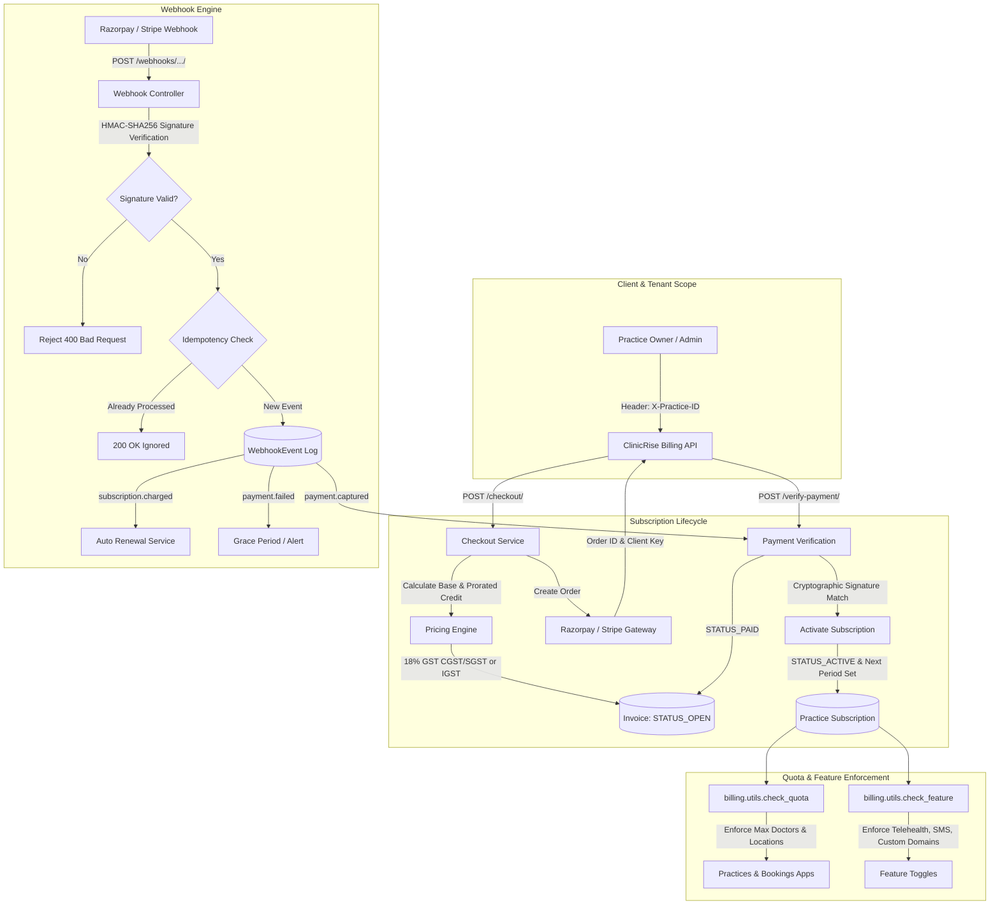
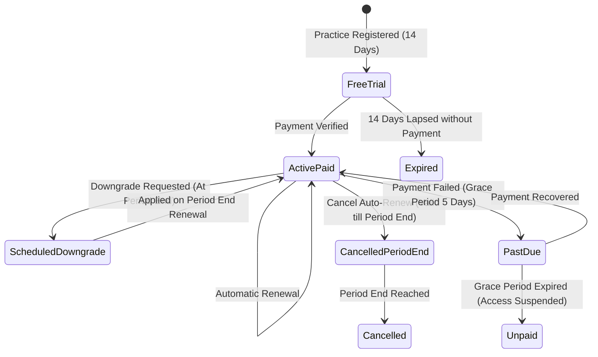

# ClinicRise Subscription Billing, Plans, Webhooks & Invoicing API

This document details the subscription billing architecture, payment gateway integration (Razorpay & Stripe), cryptographic webhook verification, itemized tax invoicing with Indian GST compliance, automated renewals, grace periods, prorated upgrades, and usage-validated plan downgrades in **ClinicRise**.

---

## 1. Architecture Overview

ClinicRise implements a multi-tenant SaaS subscription billing engine scoped per medical clinic or healthcare practice (`Practice`).



---

## 2. Subscription Plans & Feature Tiers

ClinicRise defines four tiered subscription plans designed for different medical practice sizes:

| Feature / Quota | 14-Day Free Trial (`trial`) | Solo Practitioner (`starter`) | Growth Polyclinic (`growth`) | Enterprise Hospital (`enterprise`) |
| :--- | :--- | :--- | :--- | :--- |
| **Monthly Price** | **₹0** | **₹1,499 / mo** | **₹3,999 / mo** | **₹8,999 / mo** |
| **Yearly Price** | — | **₹14,990 / yr** *(17% off)* | **₹39,990 / yr** *(17% off)* | **₹89,990 / yr** *(17% off)* |
| **Doctor Profiles** | 1 Doctor | 1 Doctor | Up to 5 Doctors | **Unlimited (-1)** |
| **Staff Accounts** | 2 Staff | 3 Staff | Up to 10 Staff | **Unlimited (-1)** |
| **Clinic Locations** | 1 Location | 1 Location | 2 Locations | **Unlimited (-1)** |
| **Appointments / Mo** | 50 / month | 250 / month | 1,000 / month | **Unlimited (-1)** |
| **Storage Quota** | 500 MB | 2,048 MB (2 GB) | 10,240 MB (10 GB) | 51,200 MB (50 GB) |
| **Digital Prescriptions** | ✅ Yes | ✅ Yes | ✅ Yes | ✅ Yes |
| **Teleconsultations** | ✅ Yes | ✅ Yes | ✅ Yes | ✅ Yes |
| **Automated SMS Reminders** | ✅ Yes | ✅ Yes | ✅ Yes | ✅ Yes |
| **WhatsApp Notifications** | ❌ No | ❌ No | ✅ Yes | ✅ Yes |
| **Custom Domain Mapping** | ❌ No | ❌ No | ✅ Yes | ✅ Yes |
| **Advanced Analytics** | ❌ No | ✅ Basic | ✅ Full Suite | ✅ Full Suite |
| **Priority 24/7 SLA** | ❌ No | ❌ No | ❌ No | ✅ Dedicated SLA |
| **REST API Webhooks** | ❌ No | ❌ No | ❌ No | ✅ Yes |

---

## 3. Subscription Lifecycle & State Machine

Every practice tenant is bound to a single active `PracticeSubscription` record:



### Subscription Status Definitions
- `trialing`: 14-day full-feature trial automatically assigned upon practice creation.
- `active`: Paid subscription in good standing with active feature access.
- `past_due`: Renewal payment pending or failed; practice is in a **5-day grace period** to avoid clinical disruptions.
- `unpaid`: Grace period ended without payment; platform features are suspended.
- `cancelled`: Subscription cancelled by practice owner; stays active until `current_period_end` unless immediately terminated.
- `expired`: Free trial or non-renewed subscription whose period has elapsed.

---

## 4. Prorated Upgrades & Validated Downgrades

### 4.1 Prorated Mid-Cycle Upgrades
When a clinic upgrades midway through an active paid cycle (e.g., from *Solo Starter* to *Growth Polyclinic*):
1. **Unused Credit Calculation**:
   $$\text{Remaining Ratio} = \frac{\text{Remaining Seconds in Cycle}}{\text{Total Seconds in Period}}$$
   $$\text{Prorated Credit} = \text{Current Plan Price} \times \text{Remaining Ratio}$$
2. **Net Charge**:
   $$\text{Net Base} = \max(0, \text{Target Plan Price} - \text{Prorated Credit})$$
3. An itemized invoice is generated displaying the target plan price and the negative line item for the unused credit.
4. Upon signature verification, the practice's quotas (doctors, locations) are expanded immediately.

---

### 4.2 Usage-Validated Plan Downgrades
Downgrading (e.g. from *Growth* with 5 doctors to *Starter* with 1 doctor) enforces strict safeguards:
1. **Usage Validation**:
   - The platform counts currently active doctors (`PracticeMembership` with role `doctor` or `owner`).
   - If active doctors exceed `target_plan.max_doctors`, the API **blocks the downgrade** with HTTP 400:
     ```json
     {
       "error": "Cannot downgrade to 'Solo Practitioner': Your practice currently has 3 active doctors, but Solo Practitioner allows a maximum of 1. Please deactivate or remove 2 doctor(s) before downgrading."
     }
     ```
   - Similar validation checks branch locations (`PracticeLocation`).
2. **Period-End Scheduling**:
   - If validation passes, the downgrade is **scheduled for `current_period_end`**.
   - The clinic continues to enjoy their higher tier until their paid period completes.
   - The clinic can cancel the scheduled downgrade anytime before `current_period_end` via `POST /api/billing/cancel-downgrade/`.
   - On the renewal date, the system automatically applies the downgraded tier and issues the renewal invoice at the lower price.

---

## 5. Indian GST & Tax Invoicing

Every invoice generated by ClinicRise complies with Indian Goods & Services Tax (GST) regulations:
- **SAC Code**: `998313` (*Information technology software and SaaS hosting services*).
- **Default GST Rate**: `18.00%`.
- **Intra-State (Telangana)**:
  - CGST: `9.00%`
  - SGST: `9.00%`
  - IGST: `0.00%`
- **Inter-State (Other Indian States/UTs)**:
  - CGST: `0.00%`
  - SGST: `0.00%`
  - IGST: `18.00%`

Each invoice includes:
- ClinicRise legal entity name, GSTIN, registered office address.
- Practice legal name, GSTIN (or "Unregistered Consumer"), registered clinic address.
- Unique alphanumeric invoice sequence: `CR-INV-YYYYMM-XXXX`.
- Printable HTML / PDF receipt available at `/api/billing/invoices/<id>/receipt/`.

---

## 6. Payment Gateways & Cryptographic Webhooks

### 6.1 Dual Gateway Architecture
- **Razorpay**: Default gateway for Indian payments (UPI, RuPay/Visa/Mastercard, Net Banking, EMI).
- **Stripe**: International gateway support (Cards, SEPA, PaymentIntents).
- **Sandbox Mode**: Seamless fallback for local testing when live API keys are not supplied in `.env`.

### 6.2 Razorpay Signature Verification
Payments submitted by the client are verified against Razorpay's HMAC-SHA256 signature algorithm:
$$\text{Expected Signature} = \text{HMAC-SHA256}(\text{order\_id} + "|" + \text{payment\_id}, \text{key\_secret})$$

### 6.3 Webhook Handling & Idempotency
- **Endpoint**: `POST /api/billing/webhooks/razorpay/`
- **Header**: `X-Razorpay-Signature`
- **Idempotency**: The `WebhookEvent` table tracks every `event_id`. Duplicate deliveries from network retries are detected and safely acknowledged with `200 OK` without double-processing.
- **Handled Events**:
  - `payment.captured` / `payment.authorized`: Automatically marks matching invoice as `paid` and upgrades/renews subscription.
  - `payment.failed`: Records failed `PaymentTransaction` audit log and enters grace period.
  - `subscription.charged`: Issues automated recurring renewal invoice.
  - `subscription.cancelled`: Updates subscription status.

---

## 7. API Reference

All authenticated endpoints require:
```http
Authorization: Bearer <access_token>
X-Practice-ID: <practice_uuid>
```

### 7.1 Plans & Pricing

#### A. List Active Subscription Plans
- **URL**: `GET /api/billing/plans/`
- **Permissions**: Public (`AllowAny`)
- **Query Params**: `?all=true` (optional: include hidden/trial plans)
- **Response (200 OK)**:
```json
[
  {
    "id": "c1f2e3d4-b5a6-4789-9012-abcdef123456",
    "name": "Solo Practitioner",
    "slug": "solo-starter",
    "tier": "starter",
    "tier_display": "Solo Starter",
    "tagline": "Ideal for individual practitioners and private clinics",
    "monthly_price": "1499.00",
    "yearly_price": "14990.00",
    "yearly_discount_percent": 17,
    "currency": "INR",
    "max_doctors": 1,
    "max_staff": 3,
    "max_locations": 1,
    "max_appointments_per_month": 250,
    "custom_domain_enabled": false,
    "teleconsultation_enabled": true,
    "sms_reminders_enabled": true,
    "whatsapp_notifications_enabled": false,
    "features_list": [
      "1 Doctor Profile included",
      "Up to 3 Staff / Receptionists",
      "1 Clinic Location",
      "250 Appointments per month"
    ]
  }
]
```

---

### 7.2 Current Subscription & Usage

#### A. Get Current Subscription Status
- **URL**: `GET /api/billing/subscription/`
- **Permissions**: Authenticated Practice Member
- **Response (200 OK)**:
```json
{
  "id": "7b58c5f0-6c92-494b-a7e6-b6059c1187d2",
  "practice_id": "4e12c98a-78b9-4321-a123-9876543210ab",
  "practice_name": "Apollo Dental Care",
  "plan": {
    "name": "Solo Practitioner",
    "tier": "starter",
    "monthly_price": "1499.00"
  },
  "status": "active",
  "status_display": "Active Paid",
  "billing_interval": "monthly",
  "current_period_start": "2026-10-19T00:00:00Z",
  "current_period_end": "2026-11-18T23:59:59Z",
  "days_remaining": 30,
  "auto_renew": true,
  "cancel_at_period_end": false,
  "scheduled_downgrade": null,
  "usage": {
    "doctors": { "used": 1, "limit": 1, "remaining": 0 },
    "staff": { "used": 1, "limit": 3, "remaining": 2 },
    "locations": { "used": 1, "limit": 1, "remaining": 0 },
    "appointments_this_month": { "used": 14, "limit": 250, "remaining": 236 }
  }
}
```

---

### 7.3 Checkout & Payment Verification

#### A. Initiate Checkout or Prorated Upgrade
- **URL**: `POST /api/billing/checkout/`
- **Permissions**: Practice Admin / Owner
- **Request Body**:
```json
{
  "plan_id": "c1f2e3d4-b5a6-4789-9012-abcdef123456",
  "interval": "monthly"
}
```
- **Response (200 OK)**:
```json
{
  "invoice_id": "8a7b6c5d-4e3f-2109-8765-fedcba987654",
  "invoice_number": "CR-INV-202610-8A1B",
  "order_id": "order_mock_98a72b1c",
  "amount": 1768.82,
  "currency": "INR",
  "key_id": "rzp_test_placeholder",
  "plan": {
    "name": "Solo Practitioner",
    "tier": "starter",
    "interval": "monthly"
  },
  "breakdown": {
    "base_price": 1499.00,
    "discount_credit": 0.00,
    "subtotal": 1499.00,
    "tax_rate_percent": 18.00,
    "tax_amount": 269.82,
    "cgst_amount": 134.91,
    "sgst_amount": 134.91,
    "igst_amount": 0.00,
    "total_amount": 1768.82
  }
}
```

---

#### B. Verify Payment Signature
- **URL**: `POST /api/billing/verify-payment/`
- **Permissions**: Practice Admin / Owner
- **Request Body**:
```json
{
  "invoice_id": "8a7b6c5d-4e3f-2109-8765-fedcba987654",
  "razorpay_order_id": "order_mock_98a72b1c",
  "razorpay_payment_id": "pay_9876543210_abcdef",
  "razorpay_signature": "mock_sig_valid",
  "payment_method": "upi"
}
```
- **Response (200 OK)**:
```json
{
  "message": "Payment verified and subscription activated successfully.",
  "invoice": {
    "id": "8a7b6c5d-4e3f-2109-8765-fedcba987654",
    "invoice_number": "CR-INV-202610-8A1B",
    "status": "paid",
    "total_amount": "1768.82"
  },
  "subscription": {
    "status": "active",
    "days_remaining": 30
  }
}
```

---

### 7.4 Downgrade & Cancellation

#### A. Schedule Plan Downgrade
- **URL**: `POST /api/billing/downgrade/`
- **Permissions**: Practice Admin / Owner
- **Request Body**:
```json
{
  "target_plan_id": "c1f2e3d4-b5a6-4789-9012-abcdef123456",
  "target_interval": "monthly",
  "immediate": false
}
```
- **Response (200 OK)**:
```json
{
  "mode": "scheduled",
  "plan": "Solo Practitioner",
  "interval": "monthly",
  "effective_date": "2026-11-18T23:59:59Z",
  "message": "Downgrade to 'Solo Practitioner' scheduled. You retain full access to your current plan until 18 Nov 2026."
}
```

---

#### B. Cancel Scheduled Downgrade
- **URL**: `POST /api/billing/cancel-downgrade/`
- **Permissions**: Practice Admin / Owner
- **Response (200 OK)**:
```json
{
  "message": "Scheduled downgrade to 'Solo Practitioner' has been cancelled. Your current plan will renew normally."
}
```

---

#### C. Cancel Subscription (Disable Auto-Renew)
- **URL**: `POST /api/billing/cancel/`
- **Permissions**: Practice Owner
- **Request Body**:
```json
{
  "reason": "Closing physical branch",
  "immediate": false
}
```
- **Response (200 OK)**:
```json
{
  "mode": "period_end",
  "status": "active",
  "effective_date": "2026-11-18T23:59:59Z",
  "message": "Subscription auto-renew turned off. Access remains active until 18 Nov 2026."
}
```

---

### 7.5 Invoices & Receipts

#### A. List Invoices
- **URL**: `GET /api/billing/invoices/`
- **Permissions**: Authenticated Practice Member
- **Query Params**: `?status=paid` | `?status=open`
- **Response (200 OK)**:
```json
[
  {
    "id": "8a7b6c5d-4e3f-2109-8765-fedcba987654",
    "invoice_number": "CR-INV-202610-8A1B",
    "plan_snapshot_name": "Solo Practitioner",
    "total_amount": "1768.82",
    "currency": "INR",
    "status": "paid",
    "status_display": "Paid",
    "paid_at": "2026-10-19T14:35:00Z",
    "receipt_url": "https://api.clinicrise.com/api/billing/invoices/8a7b6c5d-4e3f-2109-8765-fedcba987654/receipt/"
  }
]
```

---

#### B. Printable HTML Tax Invoice Receipt
- **URL**: `GET /api/billing/invoices/<id>/receipt/`
- **Permissions**: Authenticated Practice Member
- **Output**: Full-featured printable HTML document (with `@media print` styling, GST tax breakdown, ClinicRise company details, and practice details ready for print or browser Save as PDF).

---

### 7.6 Payment Gateway Webhooks

#### A. Razorpay Webhook
- **URL**: `POST /api/billing/webhooks/razorpay/`
- **Permissions**: Public (`AllowAny`)
- **Headers**:
  ```http
  X-Razorpay-Signature: <hmac_sha256_hex>
  Content-Type: application/json
  ```
- **Response (200 OK)**:
```json
{
  "status": "ok",
  "event_id": "evt_987654321",
  "event_status": "processed"
}
```

---

## 8. Integration with Other Django Apps

Other apps (`practices`, `bookings`, `websites`, `leads`) can enforce plan limits and feature locks using standard helper methods:

```python
from billing.utils import check_quota, check_feature, RequireSubscriptionFeature

# 1. Enforce Doctor limit before creating/inviting a doctor
allowed, used, limit, message = check_quota(practice, 'doctors')
if not allowed:
    raise ValidationError(message)

# 2. Check if Telehealth is enabled for this practice
is_enabled, error_msg = check_feature(practice, 'teleconsultation_enabled')
if not is_enabled:
    raise PermissionDenied(error_msg)

# 3. DRF View Permission Class
class VideoConsultationView(APIView):
    permission_classes = [IsAuthenticated, RequireSubscriptionFeature('teleconsultation_enabled')]
```

---

## 9. Cron / Management Commands

Run the automated renewal, grace-period, and expiration job daily via cron or Celery:

```bash
# Process daily subscription expirations, scheduled downgrades & grace periods
python manage.py process_subscription_renewals

# Seed standard ClinicRise plans
python manage.py seed_billing_plans
```
