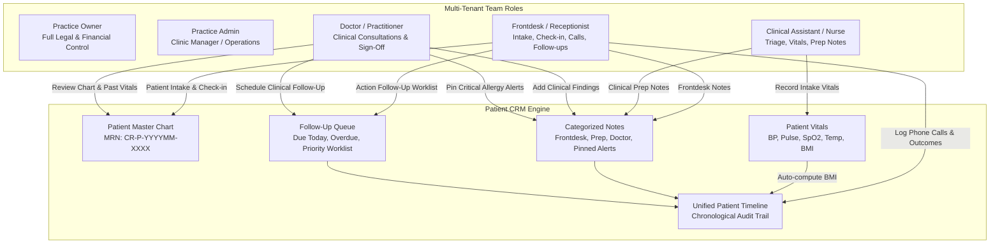
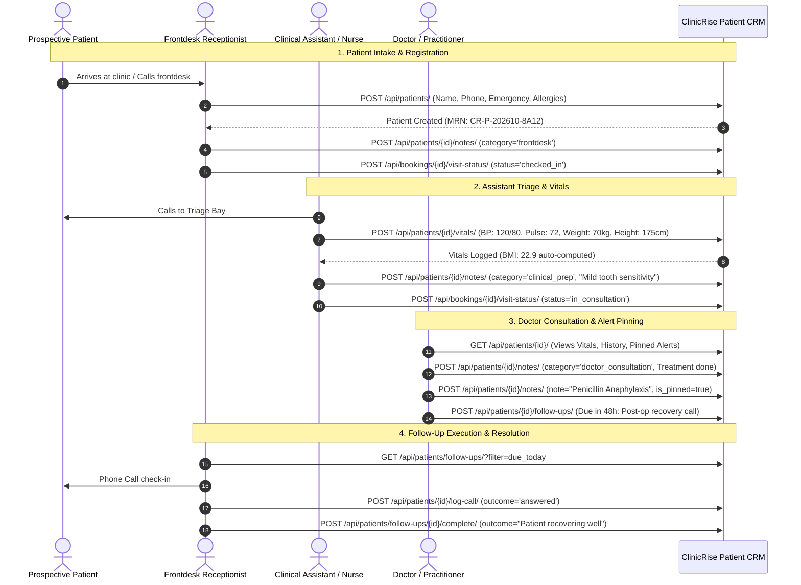

# ClinicRise Team Access & Healthcare CRM API: Receptionists, Assistants, Patient Timelines, Notes & Follow-ups

This document provides a comprehensive technical guide to the **ClinicRise Team Access and Outpatient Healthcare CRM Engine**. It details multi-tenant role-based access control (RBAC) for receptionists, clinical assistants, nurses, and doctors; unified patient medical charts; vitals recording; categorized and pinned clinical notes; actionable follow-up task queues; and chronological patient timelines.

---

## 1. Outpatient Healthcare CRM vs. Generic Sales CRM

Standard CRM software (Salesforce, HubSpot, Zoho) is designed for linear B2B or e-commerce sales funnels. In a clinical outpatient practice (dental clinics, multispecialty polyclinics, daycare surgical centers, and therapy clinics), patient interactions are ongoing, clinical, and multidisciplinary:

1. **Role-Delineated Clinical Handoffs**:
   - **Receptionists**: Manage front-of-house check-in, token assignment, intake demographics, phone call logs, payment notes, and routine follow-up calls.
   - **Clinical Assistants / Nurses**: Escort patient to prep bay, record vital signs (BP, Pulse, SpO2, Temperature, Weight, Height, BMI), capture chief complaints, and hand off to attending physician.
   - **Doctors / Practitioners**: Review past history, pinned alerts, and current vitals, conduct physical examination, add clinical diagnosis notes, pin critical alerts (e.g. penicillin anaphylaxis), and prescribe treatments.
2. **Clinical Safety & Pinned Alerts**:
   - Medical alerts (e.g. severe drug allergies, latex allergy, bleeding disorders, pacemaker, dental phobia) must never be buried in pages of text. They are pinned prominently at the top of the patient's chart.
3. **Unified Patient Timeline**:
   - A single, immutable chronological feed capturing every clinic interaction: appointment bookings, frontdesk check-ins, recorded vitals, doctor notes, follow-up calls, WhatsApp messages, and consent updates.
4. **Actionable Follow-Up Queues**:
   - Post-consultation checks (e.g., 24h post-extraction recovery), lab report reviews, medication tolerance checks, and routine periodic recalls (e.g., 6-month dental checkup) scheduled with assigned frontdesk or nursing staff.

---

## 2. System Architecture & Role Capabilities



---

## 3. Role Permissions & Capability Matrix

ClinicRise enforces strict role-based access control across practice members:

| Capability / Action | Owner | Admin | Doctor | Receptionist | Assistant |
| :--- | :---: | :---: | :---: | :---: | :---: |
| **Manage Billing & Practice Settings** | ✅ | ❌ | ❌ | ❌ | ❌ |
| **Invite / Deactivate Team Members** | ✅ | ✅ | ❌ | ❌ | ❌ |
| **Register & Edit Patient Demographics** | ✅ | ✅ | ✅ | ✅ | ✅ |
| **Frontdesk Check-In & Token Queue** | ✅ | ✅ | ✅ | ✅ | ❌ |
| **Record Clinical Vitals (BP, SpO2, BMI)** | ✅ | ✅ | ✅ | ❌ | ✅ |
| **Clinical Assistant Prep Notes** | ✅ | ✅ | ✅ | ❌ | ✅ |
| **Doctor Consultation Notes & Diagnosis** | ✅ | ✅ | ✅ | ❌ | ❌ |
| **Pin / Unpin Critical Clinical Alerts** | ✅ | ✅ | ✅ | ❌ | ❌ |
| **Log Frontdesk Phone Calls** | ✅ | ✅ | ❌ | ✅ | ❌ |
| **Execute & Complete Follow-Up Tasks** | ✅ | ✅ | ✅ | ✅ | ✅ |
| **1-Click Convert Lead to Patient** | ✅ | ✅ | ✅ | ✅ | ❌ |
| **View Audit & Compliance Timeline** | ✅ | ✅ | ✅ | ✅ | ✅ |

---

## 4. Patient Care Cycle & Clinical Workflow



---

## 5. REST API Reference

All practice CRM endpoints require standard JWT authentication (`Authorization: Bearer <token>`) and tenant scoping (`X-Practice-ID: <practice_uuid>`).

### 5.1 Team Access & Role Hierarchy

#### `GET /api/practices/roles/`
Returns the role definitions, descriptions, categories, and capability lists.

**Response (200 OK)**:
```json
{
  "roles": [
    {
      "code": "owner",
      "name": "Practice Owner",
      "description": "Full legal and operational control over clinic practice, billing, and team memberships.",
      "capabilities": ["manage_billing", "invite_team", "remove_team", "manage_clinical", "manage_patients", "view_audit_logs"],
      "category": "leadership"
    },
    {
      "code": "admin",
      "name": "Practice Admin",
      "description": "Clinic manager / practice administrator overseeing team onboarding, clinic settings, and scheduling.",
      "capabilities": ["invite_team", "edit_team", "manage_clinical", "manage_patients", "view_reports"],
      "category": "administration"
    },
    {
      "code": "doctor",
      "name": "Doctor / Practitioner",
      "description": "Licensed healthcare practitioner managing OPD consultations, clinical notes, prescriptions, and review sign-offs.",
      "capabilities": ["consult_patients", "clinical_notes", "prescriptions", "approve_medical_content", "schedule_followups"],
      "category": "clinical"
    },
    {
      "code": "receptionist",
      "name": "Frontdesk / Receptionist",
      "description": "Front-of-house staff managing patient intake, walk-in tokens, appointment check-ins, call logs, and routine follow-ups.",
      "capabilities": ["register_patients", "check_in_patients", "manage_bookings", "frontdesk_notes", "log_calls", "execute_followups"],
      "category": "frontdesk"
    },
    {
      "code": "assistant",
      "name": "Clinical Assistant / Nurse",
      "description": "Healthcare assistant / triage nurse recording patient vitals, intake preparation, clinical notes, and procedure assistance.",
      "capabilities": ["record_vitals", "intake_prep_notes", "view_patient_chart", "assist_consultation", "execute_followups"],
      "category": "clinical_support"
    },
    {
      "code": "staff",
      "name": "General Staff",
      "description": "General clinic staff supporting scheduling, basic intake, and coordination.",
      "capabilities": ["view_bookings", "basic_intake", "manage_schedule"],
      "category": "support"
    }
  ]
}
```

#### `GET /api/practices/{practice_id}/members/?role=receptionist`
Filters practice staff by role (`receptionist`, `assistant`, `doctor`, `admin`, `owner`).

---

### 5.2 Patient Directory & Charting

#### `GET /api/patients/`
Search and list patients in the active practice.

**Query Parameters**:
- `search`: Filter by name, phone number, MRN, or email
- `status`: `active` | `archived` | `inactive`
- `blood_group`: `A+`, `B+`, `O+`, etc.
- `has_allergies`: `true` | `false`
- `doctor_id`: Filter by assigned primary doctor

**Response (200 OK)**:
```json
[
  {
    "id": "e4b2c1a0-9876-5432-10fe-abcdef123456",
    "patient_id": "CR-P-202610-8A12",
    "first_name": "Arjun",
    "last_name": "Reddy",
    "full_name": "Arjun Reddy",
    "phone_number": "+919876543210",
    "email": "arjun.reddy@example.com",
    "gender": "male",
    "gender_display": "Male",
    "age": 32,
    "blood_group": "O+",
    "status": "active",
    "allergies": "Penicillin, Sulfa drugs",
    "has_allergies": true,
    "medical_alerts": "Severe penicillin anaphylaxis",
    "has_medical_alerts": true,
    "tags": ["VIP", "Anxious"],
    "total_visits_count": 3,
    "last_visit_date": "2026-10-20",
    "created_at": "2026-10-22T04:15:00Z"
  }
]
```

#### `POST /api/patients/`
Registers a new patient.

**Request Body**:
```json
{
  "first_name": "Arjun",
  "last_name": "Reddy",
  "phone_number": "9876543210",
  "email": "arjun.reddy@example.com",
  "gender": "male",
  "date_of_birth": "1994-06-15",
  "blood_group": "O+",
  "address": "Flat 402, Green Glen Layout, Bellandur",
  "city": "Bengaluru",
  "postal_code": "560103",
  "emergency_contact_name": "Kavita Reddy",
  "emergency_contact_phone": "+919876543211",
  "emergency_contact_relation": "Spouse",
  "allergies": "Penicillin",
  "chronic_conditions": ["Mild Hypertension"],
  "medical_alerts": "Severe penicillin anaphylaxis",
  "tags": ["VIP", "Dental Anxiety"],
  "source": "walk_in",
  "preferred_language": "English"
}
```

#### `GET /api/patients/{id}/`
Returns the complete patient chart, including **pinned clinical alerts**, **latest vitals**, and **pending follow-ups count**.

**Response (200 OK)**:
```json
{
  "id": "e4b2c1a0-9876-5432-10fe-abcdef123456",
  "patient_id": "CR-P-202610-8A12",
  "full_name": "Arjun Reddy",
  "phone_number": "+919876543210",
  "email": "arjun.reddy@example.com",
  "gender_display": "Male",
  "age": 32,
  "blood_group": "O+",
  "emergency_contact_name": "Kavita Reddy",
  "emergency_contact_phone": "+919876543211",
  "emergency_contact_relation": "Spouse",
  "allergies": "Penicillin",
  "medical_alerts": "Severe penicillin anaphylaxis",
  "tags": ["VIP", "Dental Anxiety"],
  "pinned_notes": [
    {
      "id": "f8a1b2c3-4d5e-6f7a-8b9c-0d1e2f3a4b5c",
      "author_name": "Dr. Ananya Deshmukh",
      "author_role": "doctor",
      "category": "general",
      "category_display": "General Administrative Note",
      "note": "CRITICAL ALERT: Patient suffered severe angioedema with Amoxicillin. DO NOT PRESCRIBE BETA-LACTAMS.",
      "is_pinned": true,
      "pinned_at": "2026-10-22T04:20:00Z"
    }
  ],
  "latest_vitals": {
    "blood_pressure_systolic": 120,
    "blood_pressure_diastolic": 80,
    "pulse_bpm": 72,
    "temperature_fahrenheit": 98.6,
    "oxygen_saturation_spo2": 99,
    "weight_kg": 70.0,
    "height_cm": 175.0,
    "bmi": 22.9,
    "recorded_by_name": "Sunita Rao",
    "created_at": "2026-10-22T04:25:00Z"
  },
  "pending_followups_count": 1,
  "total_visits_count": 3
}
```

---

### 5.3 Clinical Vitals & Assistant Triage

#### `POST /api/patients/{id}/vitals/`
Recorded by clinical assistant or nurse during intake prep.

**Request Body**:
```json
{
  "blood_pressure_systolic": 120,
  "blood_pressure_diastolic": 80,
  "pulse_bpm": 72,
  "temperature_fahrenheit": 98.6,
  "oxygen_saturation_spo2": 99,
  "respiratory_rate": 16,
  "weight_kg": 70.0,
  "height_cm": 175.0,
  "blood_sugar_random": 105,
  "notes": "Patient well-rested, no dizziness, ready for doctor examination."
}
```

**Response (201 Created)**:
BMI is automatically computed ($70 / (1.75^2) = 22.9$) and logged to the timeline:
```json
{
  "id": "a1b2c3d4-e5f6-7890-abcd-ef1234567890",
  "patient": "e4b2c1a0-9876-5432-10fe-abcdef123456",
  "blood_pressure_systolic": 120,
  "blood_pressure_diastolic": 80,
  "pulse_bpm": 72,
  "temperature_fahrenheit": "98.6",
  "oxygen_saturation_spo2": 99,
  "weight_kg": "70.00",
  "height_cm": "175.0",
  "bmi": "22.9",
  "recorded_by_name": "Sunita Rao",
  "created_at": "2026-10-22T04:25:00Z"
}
```

---

### 5.4 Categorized Notes & Pinned Alerts

#### `POST /api/patients/{id}/notes/`
Allows team members to record notes across 5 categories:
- `frontdesk`: Front-of-house intake, payment discussions, billing remarks
- `clinical_prep`: Assistant triage remarks, symptom prep
- `doctor_consultation`: Clinical examination observations and diagnosis
- `follow_up`: Outcome from patient recovery calls
- `general`: Administrative observations

**Request Body**:
```json
{
  "note": "CRITICAL ALERT: Patient suffered severe angioedema with Amoxicillin. DO NOT PRESCRIBE BETA-LACTAMS.",
  "category": "doctor_consultation",
  "is_pinned": true
}
```

#### `POST /api/patients/{id}/notes/{note_id}/pin/`
Toggles the pinned status of a note. Pinned notes stay at the top of the patient chart.

---

### 5.5 Phone Call Logging (Receptionist Frontdesk)

#### `POST /api/patients/{id}/log-call/`
Enables frontdesk staff to log inbound/outbound calls with structured outcomes.

**Request Body**:
```json
{
  "call_type": "outgoing",
  "outcome": "answered",
  "notes": "Confirmed patient arriving 15 minutes before 10am slot for dental scaling."
}
```

**Response (201 Created)**:
Automatically creates a `frontdesk` note and logs `EVENT_PHONE_CALL` to the patient timeline.

---

### 5.6 Actionable Follow-Up Worklist

#### `POST /api/patients/{id}/follow-ups/`
Schedules a task for a team member.

**Request Body**:
```json
{
  "title": "Post-extraction recovery check",
  "follow_up_type": "post_consultation_check",
  "priority": "high",
  "due_date": "2026-10-24T10:00:00Z",
  "instructions": "Call patient to check bleeding and pain levels. Ensure ice pack applied.",
  "assigned_to_id": "u-receptionist-uuid"
}
```

#### `GET /api/patients/follow-ups/`
Global worklist for receptionists and nurses.

**Query Parameters**:
- `filter`: `due_today` | `overdue` | `upcoming` | `completed` | `all`
- `assigned_to`: `<user_uuid>` | `me`
- `priority`: `urgent` | `high` | `medium` | `low`

**Response (200 OK)**:
```json
[
  {
    "id": "c1d2e3f4-5a6b-7c8d-9e0f-1a2b3c4d5e6f",
    "patient_name": "Arjun Reddy",
    "patient_phone": "+919876543210",
    "title": "Post-extraction recovery check",
    "follow_up_type": "post_consultation_check",
    "follow_up_type_display": "Post-Consultation / Procedure Check",
    "priority": "high",
    "priority_display": "High Priority",
    "due_date": "2026-10-24T10:00:00Z",
    "status": "pending",
    "status_display": "Pending",
    "instructions": "Call patient to check bleeding and pain levels. Ensure ice pack applied.",
    "assigned_to_name": "Priya Nair"
  }
]
```

#### `POST /api/patients/follow-ups/{id}/complete/`
Resolves the follow-up task and records outcome notes.

**Request Body**:
```json
{
  "outcome_notes": "Spoke with patient. Bleeding stopped completely. Pain 2/10 managed with prescribed medication."
}
```

---

### 5.7 1-Click Lead Conversion

#### `POST /api/patients/convert-lead/{lead_id}/`
Converts a prospective marketing inquiry (`Lead`) from website forms or WhatsApp into a registered `Patient` record, preserving contact info and linking the original inquiry.

---

### 5.8 Unified Patient Timeline

#### `GET /api/patients/{id}/timeline/`
Returns the chronological audit trail of all patient touchpoints:

**Response (200 OK)**:
```json
[
  {
    "id": "t1-uuid",
    "performer_role": "receptionist",
    "performed_by_name": "Priya Nair",
    "event_type": "follow_up_completed",
    "event_type_display": "Follow-up Task Completed",
    "title": "Follow-up Completed: Post-extraction recovery check",
    "description": "Spoke with patient. Bleeding stopped completely. Pain 2/10 managed with prescribed medication.",
    "created_at": "2026-10-24T10:15:00Z"
  },
  {
    "id": "t2-uuid",
    "performer_role": "receptionist",
    "performed_by_name": "Priya Nair",
    "event_type": "phone_call_logged",
    "event_type_display": "Phone Call Logged",
    "title": "Phone Call Logged (Outgoing - Answered)",
    "description": "Call Type: Outgoing | Outcome: Answered\nNotes: Checked post-op condition.",
    "created_at": "2026-10-24T10:14:00Z"
  },
  {
    "id": "t3-uuid",
    "performer_role": "doctor",
    "performed_by_name": "Dr. Ananya Deshmukh",
    "event_type": "clinical_note_added",
    "event_type_display": "Staff / Clinical Note Recorded",
    "title": "Clinical Note Added [PINNED ALERT]",
    "description": "CRITICAL ALERT: Patient suffered severe angioedema with Amoxicillin. DO NOT PRESCRIBE BETA-LACTAMS.",
    "created_at": "2026-10-22T04:20:00Z"
  },
  {
    "id": "t4-uuid",
    "performer_role": "assistant",
    "performed_by_name": "Sunita Rao",
    "event_type": "vitals_recorded",
    "event_type_display": "Vitals Recorded by Clinical Assistant",
    "title": "Vitals Recorded by Clinical Assistant",
    "description": "BP: 120/80 mmHg, Pulse: 72 bpm, Temp: 98.6 °F, SpO2: 99%, Weight: 70.0 kg, BMI: 22.9",
    "created_at": "2026-10-22T04:25:00Z"
  },
  {
    "id": "t5-uuid",
    "performer_role": "receptionist",
    "performed_by_name": "Priya Nair",
    "event_type": "patient_created",
    "event_type_display": "Patient Registered / Intake",
    "title": "Patient Registered",
    "description": "Patient Arjun Reddy (CR-P-202610-8A12) registered at clinic.",
    "created_at": "2026-10-22T04:15:00Z"
  }
]
```

---

### 5.9 CRM Overview Dashboard

#### `GET /api/patients/overview/`
Returns practice-wide operational metrics:
```json
{
  "total_active_patients": 412,
  "new_patients_this_month": 38,
  "pending_followups_count": 14,
  "followups_due_today": 6,
  "followups_overdue": 2,
  "pinned_clinical_alerts_count": 23
}
```

---

## 6. Verification & Automated Test Suite

The team access and CRM subsystem is verified with automated tests covering all roles and workflows:
- **`patients/tests.py`**: 8 comprehensive test cases testing:
  - Role matrix (`roles/`) and member role filtering (`?role=receptionist`, `?role=assistant`)
  - Team invitations for receptionists and clinical assistants
  - Patient intake, MRN generation, and E.164 phone normalization
  - Clinical Assistant vitals intake and auto-BMI calculation
  - Frontdesk phone call logging and categorized notes
  - Doctor consultation notes and pinned clinical alert banners
  - Follow-up queue worklist and resolution
  - 1-Click marketing lead conversion
  - Practice CRM overview statistics

Run tests:
```bash
python manage.py test patients
```
