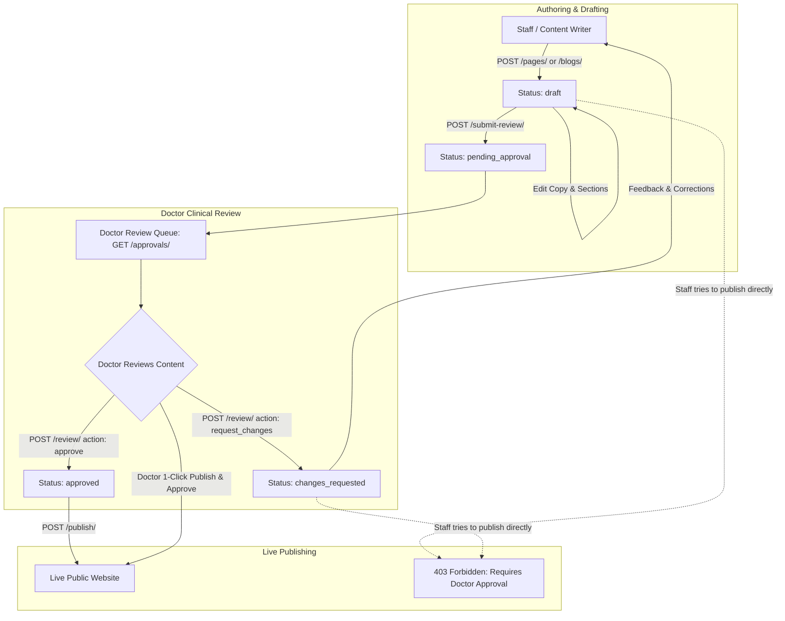

# ClinicRise Website Content Approvals & Medical Blog Review API

This document details the medical content governance architecture, role-based approval workflow, doctor review gates, and clinical blog drafting system in **ClinicRise**.

---

## 1. Healthcare Content Governance & Why It Matters

In a clinical practice (dental clinic, multispecialty polyclinic, or hospital), marketing personnel, frontdesk staff, or copywriters frequently update website copy or draft health articles. However, healthcare content carries legal, ethical, and clinical consequences:
- Medical claims (e.g. success rates, treatment outcomes) must be clinically accurate.
- Dosages, procedural steps, and recovery guidelines require medical doctor sign-off.
- State medical council advertising regulations require practitioner oversight.

ClinicRise implements a **Doctor Content Approval Gate**:
1. Staff members can draft website changes and blog articles.
2. Drafts must be submitted for doctor review (`pending_approval`).
3. Only verified medical practitioners (`doctor` or `owner` role) can sign off (`approved`) or request changes (`changes_requested`).
4. Staff publishing is strictly gated: attempting to publish unapproved content returns `403 Forbidden`.



---

## 2. Review Roles & Permissions

| Role | Submit for Review | Review & Approve | Request Changes | Publish Approved Content | Publish Unapproved Directly |
| :--- | :---: | :---: | :---: | :---: | :---: |
| **Frontdesk / Staff** | ✅ Yes | ❌ No | ❌ No | ✅ Yes (If approved) | ❌ Blocked (403) |
| **Doctor / Practitioner** | ✅ Yes | ✅ Yes | ✅ Yes | ✅ Yes | ✅ Yes |
| **Practice Admin** | ✅ Yes | ✅ Yes | ✅ Yes | ✅ Yes | ✅ Yes |
| **Practice Owner** | ✅ Yes | ✅ Yes | ✅ Yes | ✅ Yes | ✅ Yes |

---

## 3. Workflow States & Lifecycle

- `draft`: Initial editing phase by staff or doctor.
- `pending_approval`: Submitted for clinical review with author notes.
- `changes_requested`: Doctor returned the draft with clinical corrections or notes.
- `approved`: Doctor verified the medical claims and approved publication.
- `published`: Content live on the public website.

> [!NOTE]
> If an approved draft is modified by a staff member before publication, the approval state automatically reverts to `draft`, requiring doctor re-approval to prevent unverified last-minute edits.

---

## 4. Unified Doctor Approval Queue

Doctors and Practice Owners can monitor all items awaiting clinical sign-off across the practice's pages and blog articles using a single consolidated review dashboard:

- **Endpoint**: `GET /api/websites/<website_id>/approvals/`
- **Optional Filter**: `?status=pending_approval` | `approved` | `changes_requested`

**Response (200 OK)**:
```json
{
  "total_pending": 2,
  "total_approved": 5,
  "total_changes_requested": 1,
  "items": [
    {
      "id": "e4b2c1a0-9876-5432-10fe-abcdef123456",
      "title": "Dental Implants & Laser Dentistry",
      "slug": "treatments",
      "content_type": "page",
      "approval_status": "pending_approval",
      "submitted_by": {
        "id": "u1-uuid",
        "name": "Priya Sharma",
        "email": "priya@apollodental.com"
      },
      "submitted_at": "2026-10-19T14:45:00Z",
      "submission_notes": "Updated treatment pricing and added new laser therapy section.",
      "has_unpublished_changes": true,
      "is_published": true
    },
    {
      "id": "f5c3d2b1-1234-5678-90ab-cdef12345678",
      "title": "5 Myths About Root Canal Treatments Debunked",
      "slug": "blog/root-canal-myths",
      "content_type": "blog_post",
      "approval_status": "pending_approval",
      "submitted_by": {
        "id": "u1-uuid",
        "name": "Priya Sharma",
        "email": "priya@apollodental.com"
      },
      "submitted_at": "2026-10-19T14:50:00Z",
      "submission_notes": "Patient education guide written for Dental Awareness Month.",
      "has_unpublished_changes": true,
      "is_published": false
    }
  ]
}
```

---

## 5. API Reference

All authenticated endpoints require:
```http
Authorization: Bearer <access_token>
X-Practice-ID: <practice_uuid>
```

---

### 5.1 Website Page Approvals

#### A. Submit Page Draft for Doctor Review
- **URL**: `POST /api/websites/<website_id>/pages/<pk>/submit-review/`
- **Permissions**: Practice Member (`IsPracticeMember`)
- **Request Body**:
```json
{
  "submission_notes": "Updated pricing table for root canal therapy and added post-op instructions."
}
```
- **Response (200 OK)**:
```json
{
  "success": true,
  "message": "Draft changes for 'Treatments & Services' have been submitted for doctor review.",
  "approval_status": "pending_approval",
  "page": {
    "id": "e4b2c1a0-9876-5432-10fe-abcdef123456",
    "title": "Treatments & Services",
    "slug": "services",
    "approval": {
      "status": "pending_approval",
      "submitted_by": {
        "name": "Priya Sharma",
        "email": "priya@clinicrise.com"
      },
      "submitted_at": "2026-10-19T14:50:00Z",
      "submission_notes": "Updated pricing table for root canal therapy and added post-op instructions."
    }
  }
}
```

---

#### B. Doctor Review & Decision (Approve or Request Changes)
- **URL**: `POST /api/websites/<website_id>/pages/<pk>/review/`
- **Permissions**: Doctor / Practice Owner (`IsPracticeDoctor` / `IsPracticeOwner`)
- **Request Body (Approve)**:
```json
{
  "action": "approve",
  "review_notes": "Medically accurate. Approved for publication."
}
```
- **Request Body (Request Changes)**:
```json
{
  "action": "request_changes",
  "review_notes": "Do not claim 100% cure rate for root canals. Change to '95% clinical success rate' and mention local anesthesia options."
}
```
- **Response (200 OK)**:
```json
{
  "success": true,
  "message": "Content approved for publication.",
  "approval_status": "approved",
  "approval": {
    "status": "approved",
    "reviewed_by": {
      "name": "Dr. Rajesh Sharma",
      "email": "rajesh@apollodental.com"
    },
    "reviewed_at": "2026-10-19T14:55:00Z",
    "review_notes": "Medically accurate. Approved for publication."
  }
}
```

---

#### C. Publish Page (Gated by Approval)
- **URL**: `POST /api/websites/<website_id>/pages/<pk>/publish/`
- **Staff Behavior**:
  - If approved: Publishes live (`200 OK`).
  - If not approved: Returns `403 Forbidden`:
    ```json
    {
      "error": "Publishing restricted: Content requires doctor approval before publication. Current status is 'Pending Doctor Review'. Please submit it for doctor review."
    }
    ```
- **Doctor / Owner Behavior**:
  - Always allowed; automatically records doctor sign-off upon publication.

---

### 5.2 Medical Blog Management & Reviews

#### A. List Blog Articles
- **URL**: `GET /api/websites/<website_id>/blogs/`
- **Query Params**: `?status=pending_approval` | `?status=draft` | `?status=approved`
- **Response (200 OK)**:
```json
[
  {
    "id": "f5c3d2b1-1234-5678-90ab-cdef12345678",
    "title": "5 Myths About Root Canal Treatments Debunked",
    "slug": "root-canal-myths",
    "category": "Endodontics",
    "excerpt": "Root canals are often feared due to common misconceptions. Here are the clinical facts.",
    "author_doctor_name": "Dr. Rajesh Sharma",
    "read_time_minutes": 4,
    "approval_status": "approved",
    "is_published": true,
    "published_at": "2026-10-19T14:55:00Z"
  }
]
```

---

#### B. Create Blog Draft
- **URL**: `POST /api/websites/<website_id>/blogs/`
- **Permissions**: Practice Member
- **Request Body**:
```json
{
  "title": "Understanding Clear Aligners vs Traditional Braces",
  "slug": "clear-aligners-vs-braces",
  "category": "Orthodontics",
  "excerpt": "A comprehensive clinical comparison to help patients choose the right orthodontic treatment.",
  "body_html": "<p>Clear aligners have revolutionized modern orthodontics...</p>",
  "cover_image_url": "https://media.clinicrise.com/blog/aligners.jpg",
  "author_doctor_name": "Dr. Rajesh Sharma",
  "tags": ["Orthodontics", "Invisalign", "Dental Care"],
  "read_time_minutes": 5
}
```
- **Response (201 Created)**:
```json
{
  "success": true,
  "message": "Blog post draft 'Understanding Clear Aligners vs Traditional Braces' created.",
  "blog": {
    "id": "a1b2c3d4-e5f6-7890-1234-567890abcdef",
    "title": "Understanding Clear Aligners vs Traditional Braces",
    "slug": "blog/clear-aligners-vs-braces",
    "approval": {
      "status": "draft"
    }
  }
}
```

---

#### C. Submit Blog Draft for Doctor Review
- **URL**: `POST /api/websites/<website_id>/blogs/<pk_or_slug>/submit-review/`
- **Request Body**:
```json
{
  "submission_notes": "Included orthodontic clinical comparison and average treatment durations."
}
```

---

#### D. Doctor Review Blog Draft
- **URL**: `POST /api/websites/<website_id>/blogs/<pk_or_slug>/review/`
- **Permissions**: Doctor / Practice Owner
- **Request Body**:
```json
{
  "action": "approve",
  "review_notes": "Clinical claims and treatment durations verified. Ready for blog publication."
}
```

---

#### E. Publish Blog Article Live
- **URL**: `POST /api/websites/<website_id>/blogs/<pk_or_slug>/publish/`
- **Permissions**: Practice Member (requires doctor approval if staff)

---

### 5.3 Public Live Blog Endpoints

Patients visiting the clinic's public website or custom domain can read published articles:

#### A. Public Blog List
- **URL**: `GET /api/websites/public/<domain_or_subdomain>/blogs/`
- **Permissions**: Public (`AllowAny`)

#### B. Public Blog Article Details
- **URL**: `GET /api/websites/public/<domain_or_subdomain>/blogs/<slug>/`
- **Permissions**: Public (`AllowAny`)
- **Response (200 OK)**:
```json
{
  "id": "a1b2c3d4-e5f6-7890-1234-567890abcdef",
  "title": "Understanding Clear Aligners vs Traditional Braces",
  "slug": "clear-aligners-vs-braces",
  "category": "Orthodontics",
  "excerpt": "A comprehensive clinical comparison to help patients choose the right orthodontic treatment.",
  "body_html": "<p>Clear aligners have revolutionized modern orthodontics...</p>",
  "cover_image_url": "https://media.clinicrise.com/blog/aligners.jpg",
  "author_doctor_name": "Dr. Rajesh Sharma",
  "read_time_minutes": 5,
  "tags": ["Orthodontics", "Invisalign", "Dental Care"],
  "published_at": "2026-10-19T14:58:00Z",
  "website": {
    "title": "Apollo Dental Care",
    "subdomain": "apollodental",
    "phone": "+919876543210",
    "booking_link": "#appointment"
  }
}
```
