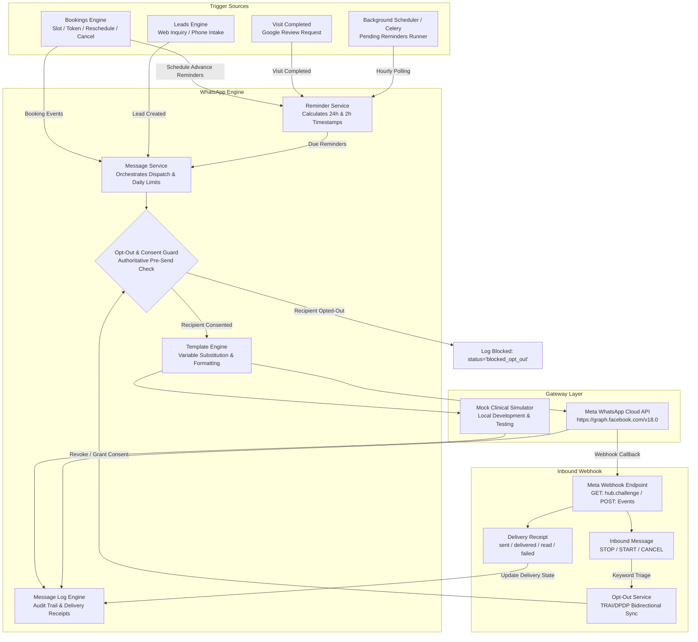
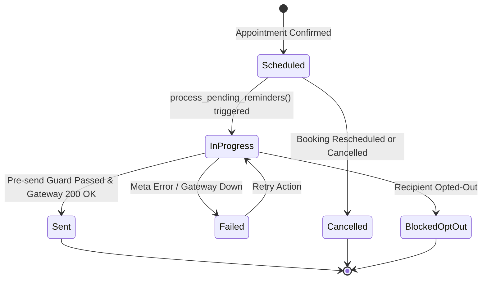
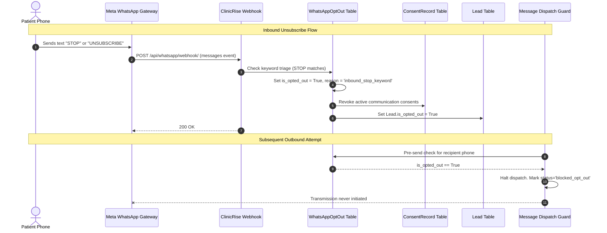

# ClinicRise WhatsApp Automation Engine: Templates, Reminders, Opt-Outs & Message Logs

This document provides a comprehensive technical reference for the **ClinicRise WhatsApp Automation Engine**. It covers multi-tenant clinical message routing, standard appointment and lead templates, scheduled reminder pipelines, regulatory opt-out compliance (TRAI DND, DPDP Act, TCPA), Meta Cloud API webhook delivery tracking, and REST API interfaces.

---

## 1. System Architecture & High-Level Flow

The WhatsApp Automation Engine operates as an event-driven, multi-tenant communication subsystem scoped to each healthcare practice (`Practice`). It interfaces with the appointment booking capacity engine (`bookings`), omnichannel patient lead pipeline (`leads`), patient data consent and audit system (`security`), and Google Business Profile reputation suite (`gbp`).



---

## 2. Core Functional Pillars

### 2.1 Clinical Template System
Healthcare communication requires clear, verifiable, and structured notification templates. ClinicRise supports:
- **Variable Placeholders**: Supports both positional format (`{{1}}`, `{{2}}`) and named key format (`{{patient_name}}`, `{{doctor_name}}`, `{{clinic_name}}`, `{{date}}`, `{{time}}`, `{{token}}`, `{{location}}`, `{{link}}`).
- **Interactive Action Buttons**: Configurable quick-reply buttons (e.g. `[Confirm]`, `[Reschedule]`, `[Cancel]`, `[Directions]`).
- **Default Seed Repository**: 8 pre-approved clinical templates seeded automatically for every practice on onboarding.
- **Provider Status Tracking**: Synchronizes approved/rejected states with Meta Business Manager.

### 2.2 Scheduled Reminders Pipeline
To reduce no-show rates (often exceeding 25% in clinical outpatient practices), ClinicRise schedules proactive reminders:
1. **24-Hour Prior Reminder**: Sent 24 hours prior to appointment slot to allow timely rescheduling if patient conflicts arise.
2. **2-Hour Immediate Reminder**: Sent 2 hours prior with clinic address, Google Maps link, and token arrival guidelines.
3. **Post-Visit GBP Review Request**: Automatically scheduled 1-2 hours after visit status changes to `completed`, soliciting 5-star Google Reviews via tracked direct review links.
4. **Reschedule / Cancellation Cascade**: When an appointment is rescheduled or cancelled, all future pending reminders are automatically cancelled or rescheduled to prevent false alerts.

### 2.3 Opt-Out & Regulatory Compliance (TRAI / DPDP Act / TCPA)
Patient privacy and anti-spam regulations require robust consent enforcement:
- **E.164 Phone Normalization**: Strips spaces, dashes, parentheses, and adds default country prefixes (e.g., converts `9876543210` to `+919876543210`).
- **Bidirectional Inbound Keyword Triage**:
  - Unsubscribe keywords: `STOP`, `UNSUBSCRIBE`, `CANCEL`, `QUIT`, `OPT OUT`, `DND`, `END`. Immediately marks `is_opted_out=True`, timestamps the opt-out, and auto-revokes consent in `security.ConsentRecord` and `leads.Lead`.
  - Resubscribe keywords: `START`, `UNSTOP`, `OPT IN`, `SUBSCRIBE`. Re-activates communications.
- **Authoritative Pre-Send Blocking Guard**: Every outbound transmission checks both `WhatsAppOptOut` and active `ConsentRecord` tables. If opted out, the message is **never dispatched to Meta**, saving API costs and preventing non-compliance fines. The message log records `status="blocked_opt_out"`.

### 2.4 Complete Message Audit Log & Delivery Receipts
- Logs all inbound and outbound payloads, timestamps, error codes, and associated foreign keys (`booking`, `lead`).
- Tracks four-stage delivery progression: `queued` $\rightarrow$ `sent` $\rightarrow$ `delivered` $\rightarrow$ `read` (or `failed` / `blocked_opt_out`).
- Built-in retry mechanism with exponential backoff capability for transient errors.
- Real-time practice analytics dashboard showing delivery rates, read rates, failures, and opt-out ratios.

---

## 3. Template Catalogue & Placeholder Dictionary

ClinicRise comes pre-configured with 8 clinical templates:

| Template Identifier | Category | Purpose | Required Placeholders |
| :--- | :--- | :--- | :--- |
| `appointment_confirmation_slot` | `appointment` | Slot-based booking confirmation with date & time | `patient_name`, `doctor_name`, `clinic_name`, `date`, `time`, `location` |
| `appointment_confirmation_token` | `appointment` | Walk-in/token-based booking confirmation | `patient_name`, `doctor_name`, `clinic_name`, `date`, `token`, `location` |
| `appointment_reminder_24h` | `reminder` | 24-hour advance reminder with confirm/reschedule prompt | `patient_name`, `doctor_name`, `clinic_name`, `date`, `time` |
| `appointment_reminder_2h` | `reminder` | 2-hour immediate alert with directions | `patient_name`, `clinic_name`, `time`, `location`, `link` |
| `appointment_rescheduled` | `appointment` | Notification when a booking is shifted | `patient_name`, `doctor_name`, `clinic_name`, `date`, `time` |
| `appointment_cancelled` | `appointment` | Notification when a booking is cancelled | `patient_name`, `clinic_name`, `date`, `link` |
| `lead_welcome` | `lead` | Instant response when a patient submits a web enquiry | `patient_name`, `clinic_name` |
| `post_visit_review` | `feedback` | Post-consultation Google Review solicitation | `patient_name`, `clinic_name`, `doctor_name`, `review_link` |

### Parameter Dictionary
- `{{patient_name}}` / `{{1}}`: Full name or preferred name of the patient.
- `{{doctor_name}}` / `{{2}}`: Attending physician or practitioner with prefix (e.g. `Dr. Sneha Rao`).
- `{{clinic_name}}` / `{{3}}`: Name of the clinic practice or branch (e.g. `Apex Dental Care - Indiranagar`).
- `{{date}}` / `{{4}}`: Formatted consultation date (e.g. `Monday, Oct 26, 2026`).
- `{{time}}` / `{{5}}`: Formatted slot time (e.g. `10:30 AM`).
- `{{token}}` / `{{5}}`: Token queue number for walk-in queues (e.g. `A-14`).
- `{{location}}` / `{{6}}`: Physical clinic address or room identifier.
- `{{link}}` / `{{review_link}}`: Direct URL for portal management, directions, or Google review page.

---

## 4. Scheduled Reminders State Machine



### Scheduling Logic
- **24-Hour Reminder**: `scheduled_for = appointment_datetime - timedelta(hours=24)`. If booking is made within 24 hours of appointment, scheduled immediately.
- **2-Hour Reminder**: `scheduled_for = appointment_datetime - timedelta(hours=2)`. If booking is made within 2 hours, reminder is skipped or queued immediately.
- **Review Request**: `scheduled_for = visit_completed_datetime + timedelta(hours=1)`. Triggered when doctor or frontdesk marks visit status `completed`.

---

## 5. Opt-Out & Consent Compliance Engine

ClinicRise implements a strict zero-tolerance guard against sending unconsented marketing or non-critical medical notifications.



### Supported Keywords
- **Opt-Out Triggers**: `stop`, `unsubscribe`, `cancel`, `quit`, `opt out`, `optout`, `dnd`, `end`.
- **Opt-In Triggers**: `start`, `unstop`, `opt in`, `optin`, `subscribe`.

---

## 6. Meta Cloud API Webhook Protocol

### 6.1 Webhook Verification Challenge (GET)
When registering your endpoint with the Meta Developer App Dashboard, Meta sends a GET verification challenge:

```http
GET /api/whatsapp/webhook/?hub.mode=subscribe&hub.challenge=1158201444&hub.verify_token=CLINICRISE_VERIFY_TOKEN HTTP/1.1
Host: api.clinicrise.com
```

**Response**:
`200 OK` with raw body `1158201444`.

### 6.2 Delivery Receipt Event (POST)
When a message moves from sent to delivered or read, Meta posts status updates:

```json
{
  "object": "whatsapp_business_account",
  "entry": [
    {
      "id": "100293847562",
      "changes": [
        {
          "value": {
            "messaging_product": "whatsapp",
            "metadata": {
              "display_phone_number": "+918049123456",
              "phone_number_id": "109876543210"
            },
            "statuses": [
              {
                "id": "wamid.HBgLMTIzNDU2Nzg5MABBAhkA",
                "status": "delivered",
                "timestamp": "1729571200",
                "recipient_id": "919876543210"
              }
            ]
          },
          "field": "messages"
        }
      ]
    }
  ]
}
```

### 6.3 Inbound Message Event (POST)
When a patient replies or sends an inbound keyword:

```json
{
  "object": "whatsapp_business_account",
  "entry": [
    {
      "id": "100293847562",
      "changes": [
        {
          "value": {
            "messaging_product": "whatsapp",
            "metadata": {
              "display_phone_number": "+918049123456",
              "phone_number_id": "109876543210"
            },
            "contacts": [
              {
                "profile": {
                  "name": "Karthik Verma"
                },
                "wa_id": "919876543210"
              }
            ],
            "messages": [
              {
                "from": "919876543210",
                "id": "wamid.HBgLMTIzNDU2Nzg5MABBAhkA",
                "timestamp": "1729571205",
                "text": {
                  "body": "STOP"
                },
                "type": "text"
              }
            ]
          },
          "field": "messages"
        }
      ]
    }
  ]
}
```

---

## 7. REST API Reference

All practice-specific endpoints require standard JWT authentication (`Authorization: Bearer <token>`) and header tenant scoping (`X-Practice-Id: <practice_uuid>`).

### 7.1 WhatsApp Practice Configuration

#### `GET /api/whatsapp/config/`
Retrieves the practice's WhatsApp provider configuration, credentials, and daily limits.

**Response (200 OK)**:
```json
{
  "id": "3fa85f64-5717-4562-b3fc-2c963f66afa6",
  "practice": "123e4567-e89b-12d3-a456-426614174000",
  "provider": "mock_simulator",
  "is_active": true,
  "phone_number_id": "109876543210",
  "business_account_id": "100293847562",
  "display_phone_number": "+91 80 4912 3456",
  "enable_appointment_confirmations": true,
  "enable_24h_reminders": true,
  "enable_2h_reminders": true,
  "enable_post_visit_reviews": true,
  "enable_lead_auto_welcome": true,
  "daily_message_limit": 1000,
  "messages_sent_today": 42
}
```

#### `POST /api/whatsapp/config/`
Updates provider credentials or messaging toggles.

**Request Body**:
```json
{
  "provider": "meta_cloud",
  "api_key": "EAAG...MetaAccessToken",
  "phone_number_id": "109876543210",
  "business_account_id": "100293847562",
  "display_phone_number": "+91 80 4912 3456",
  "enable_appointment_confirmations": true,
  "enable_24h_reminders": true,
  "enable_2h_reminders": true,
  "enable_post_visit_reviews": true,
  "daily_message_limit": 2500
}
```

---

### 7.2 Template Management

#### `GET /api/whatsapp/templates/`
Lists all templates defined for the active practice.

**Query Parameters**:
- `category` (optional): Filter by `appointment`, `reminder`, `feedback`, `lead`, `marketing`, `alert`.
- `status` (optional): Filter by `approved`, `pending_approval`, `rejected`, `draft`.

**Response (200 OK)**:
```json
[
  {
    "id": "7b587a8f-2879-4564-88aa-b77823e20011",
    "name": "appointment_confirmation_slot",
    "category": "appointment",
    "language": "en",
    "status": "approved",
    "header_text": "Appointment Confirmed",
    "body_text": "Hello {{patient_name}}, your appointment with {{doctor_name}} at {{clinic_name}} is confirmed for {{date}} at {{time}}. Location: {{location}}. Please arrive 10 mins early.",
    "footer_text": "Reply STOP to unsubscribe",
    "buttons": [
      {"type": "QUICK_REPLY", "text": "Reschedule"},
      {"type": "QUICK_REPLY", "text": "Cancel"}
    ],
    "variables": ["patient_name", "doctor_name", "clinic_name", "date", "time", "location"]
  }
]
```

#### `POST /api/whatsapp/templates/seed_defaults/`
Idempotently seeds all 8 standard clinical templates for the practice.

**Response (201 Created)**:
```json
{
  "status": "success",
  "created_count": 8,
  "message": "Default clinical WhatsApp templates seeded successfully."
}
```

---

### 7.3 Opt-Out & Compliance Management

#### `GET /api/whatsapp/opt-outs/`
Lists all phone numbers currently opted out from WhatsApp messaging.

**Query Parameters**:
- `search`: Filter by phone number.
- `reason`: Filter by reason (`inbound_stop_keyword`, `patient_request_frontdesk`, `compliance_dnd`, `consent_withdrawn`).

**Response (200 OK)**:
```json
[
  {
    "id": "a1b2c3d4-e5f6-7890-abcd-ef1234567890",
    "phone_number": "+919876543210",
    "is_opted_out": true,
    "opted_out_at": "2026-10-22T04:15:00Z",
    "opted_in_at": null,
    "reason": "inbound_stop_keyword",
    "notes": "Patient sent STOP via WhatsApp"
  }
]
```

#### `POST /api/whatsapp/opt-outs/opt_out/`
Frontdesk or compliance officer records a manual opt-out request.

**Request Body**:
```json
{
  "phone_number": "+919876543210",
  "reason": "patient_request_frontdesk",
  "notes": "Patient requested no WhatsApp messages at frontdesk"
}
```

**Response (200 OK)**:
```json
{
  "status": "opted_out",
  "phone_number": "+919876543210",
  "is_opted_out": true,
  "notes": "Patient requested no WhatsApp messages at frontdesk"
}
```

#### `POST /api/whatsapp/opt-outs/opt_in/`
Re-subscribes a patient after explicit written or verbal consent is granted.

**Request Body**:
```json
{
  "phone_number": "+919876543210",
  "notes": "Patient re-consented on physical intake form"
}
```

#### `GET /api/whatsapp/opt-outs/check/?phone_number=+919876543210`
Pre-flight verification endpoint to check whether a recipient can be messaged.

**Response (200 OK)**:
```json
{
  "phone_number": "+919876543210",
  "is_opted_out": false,
  "can_send": true
}
```

---

### 7.4 Scheduled Reminders Queue

#### `GET /api/whatsapp/reminders/`
Lists scheduled, dispatched, or failed appointment and GBP reminders.

**Query Parameters**:
- `status`: `pending`, `sent`, `failed`, `cancelled`, `blocked_opt_out`.
- `reminder_type`: `24h_prior`, `2h_prior`, `post_visit_review`, `custom`.
- `booking_id`: Specific appointment UUID.

#### `POST /api/whatsapp/reminders/process_pending/`
Manually triggers the pending reminder batch execution runner (useful for on-demand worker testing or cron webhooks).

**Response (200 OK)**:
```json
{
  "status": "completed",
  "processed_count": 14,
  "sent": 13,
  "failed": 0,
  "blocked_opt_out": 1
}
```

---

### 7.5 Message Logs & Analytics

#### `GET /api/whatsapp/logs/`
Paginated audit trail of all inbound and outbound WhatsApp communications.

**Query Parameters**:
- `direction`: `outbound` | `inbound`
- `status`: `sent` | `delivered` | `read` | `failed` | `blocked_opt_out`
- `recipient`: Phone number substring
- `booking_id`: Filter by associated booking

**Response (200 OK)**:
```json
{
  "count": 128,
  "results": [
    {
      "id": "e8a1f4b2-3c5d-6e7f-8a9b-0c1d2e3f4a5b",
      "direction": "outbound",
      "recipient_phone": "+919876543210",
      "template_name": "appointment_confirmation_slot",
      "status": "read",
      "message_content": "Hello Rahul, your appointment with Dr. Sneha Rao at Apex Clinic is confirmed for Monday, Oct 26 at 10:30 AM.",
      "sent_at": "2026-10-22T04:20:00Z",
      "delivered_at": "2026-10-22T04:20:02Z",
      "read_at": "2026-10-22T04:22:15Z",
      "cost_tier": "utility",
      "booking": "b4e2c1a0-1234-5678-90ab-cdef12345678"
    }
  ]
}
```

#### `POST /api/whatsapp/logs/{id}/retry/`
Retries a failed outbound message transmission.

**Response (200 OK)**:
```json
{
  "status": "success",
  "new_status": "sent",
  "attempt_count": 2,
  "provider_message_id": "mock-msg-919876543210-retry-1729571250"
}
```

#### `GET /api/whatsapp/logs/analytics/`
Aggregated operational metrics for executive practice reporting.

**Response (200 OK)**:
```json
{
  "total_sent": 850,
  "total_delivered": 838,
  "total_read": 745,
  "total_failed": 12,
  "total_blocked_opt_out": 8,
  "delivery_rate_pct": 98.59,
  "read_rate_pct": 88.90,
  "opt_outs_count": 15
}
```

---

### 7.6 Direct Test Dispatch

#### `POST /api/whatsapp/send-test/`
Allows practice administrators to verify gateway connectivity and preview template rendering on their personal device.

**Request Body**:
```json
{
  "recipient_phone": "+919876543210",
  "template_name": "appointment_confirmation_slot",
  "context_data": {
    "patient_name": "Karthik Verma",
    "doctor_name": "Dr. Sneha Rao",
    "clinic_name": "Apex Polyclinic",
    "date": "Monday, Oct 26, 2026",
    "time": "10:30 AM",
    "location": "Suite 401, Indiranagar, Bengaluru"
  }
}
```

**Response (200 OK)**:
```json
{
  "status": "sent",
  "log_id": "f2a1b3c4-5d6e-7f8a-9b0c-1d2e3f4a5b6c",
  "provider_message_id": "mock-msg-+919876543210-1729571300",
  "rendered_content": "Hello Karthik Verma, your appointment with Dr. Sneha Rao at Apex Polyclinic is confirmed for Monday, Oct 26, 2026 at 10:30 AM. Location: Suite 401, Indiranagar, Bengaluru."
}
```

---

## 8. Cron & Background Task Automation

ClinicRise includes a runner method to process pending reminders:

```python
from whatsapp.services.reminder_service import WhatsAppReminderService

# Invoked every 5-15 minutes via Celery Beat or Windows Task Scheduler
results = WhatsAppReminderService.process_pending_reminders(batch_size=100)
print(f"Processed: {results['processed']}, Sent: {results['sent']}, Failed: {results['failed']}")
```

### Recommended Cron Setup
```bash
# Execute reminder sweep every 10 minutes
*/10 * * * * cd /path/to/ClinicRise && python manage.py shell -c "from whatsapp.services.reminder_service import WhatsAppReminderService; WhatsAppReminderService.process_pending_reminders()"
```

---

## 9. Verification & Automated Test Suite

The WhatsApp automation suite is verified with comprehensive automated tests:
- **`whatsapp/tests.py`**: 19 tests verifying template seeding, placeholder substitution, opt-out keyword triage, pre-send blocking, reminders pipeline, Meta webhooks, analytics, and test dispatch.
- **Cross-App Integration**: Verified against `bookings/tests.py` and `leads/tests.py` (24 passing tests) ensuring zero regression in existing workflows.

To run the complete verification suite:
```bash
python manage.py test whatsapp bookings leads
```
